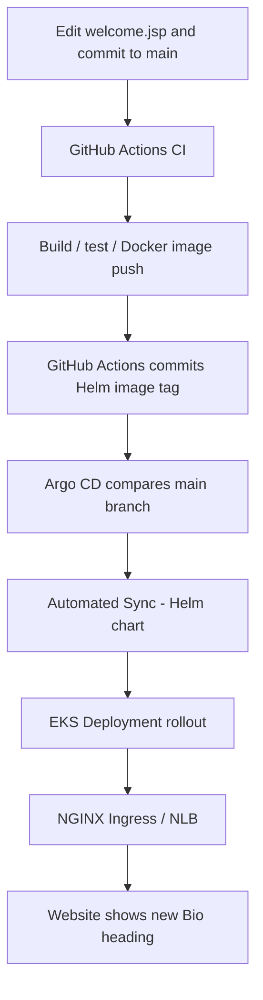
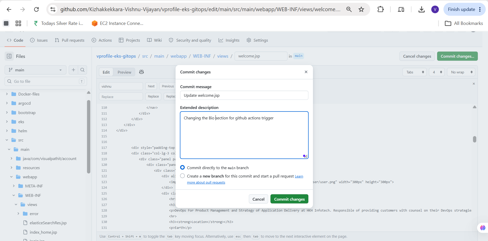
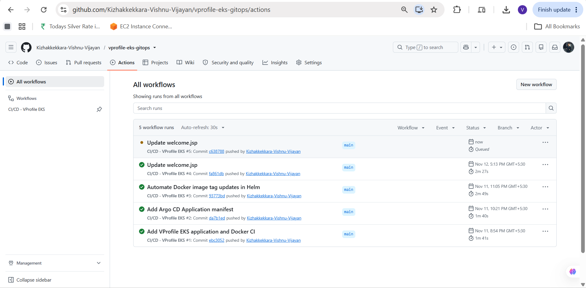
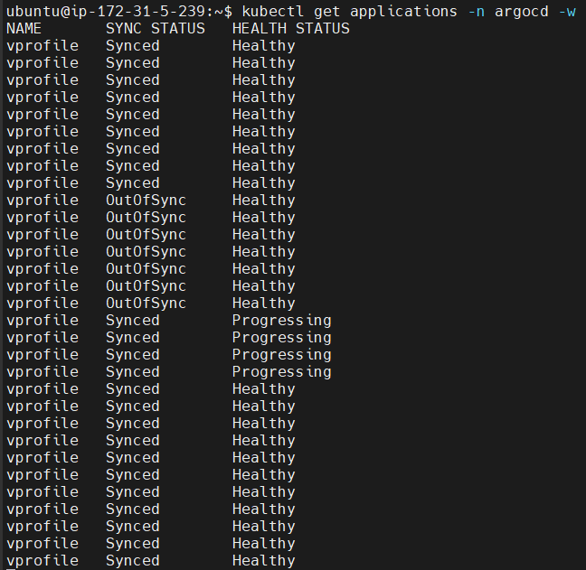
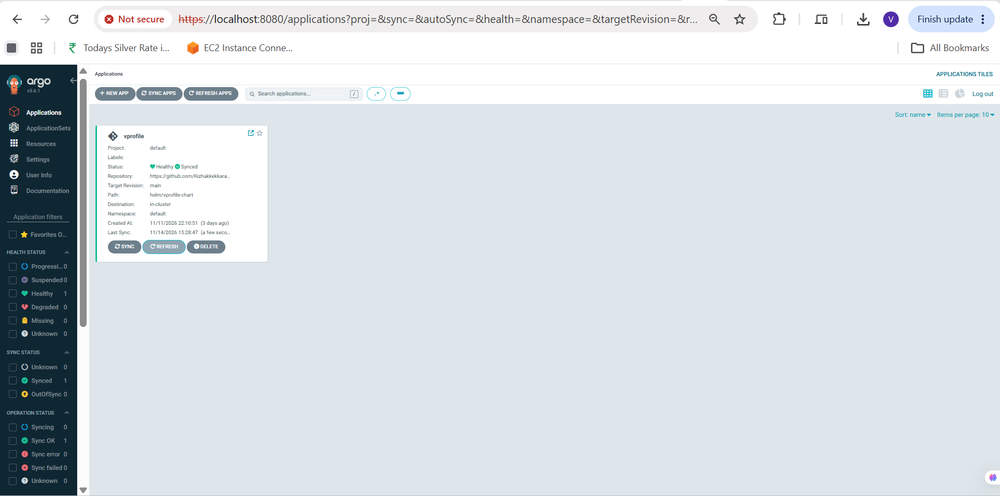
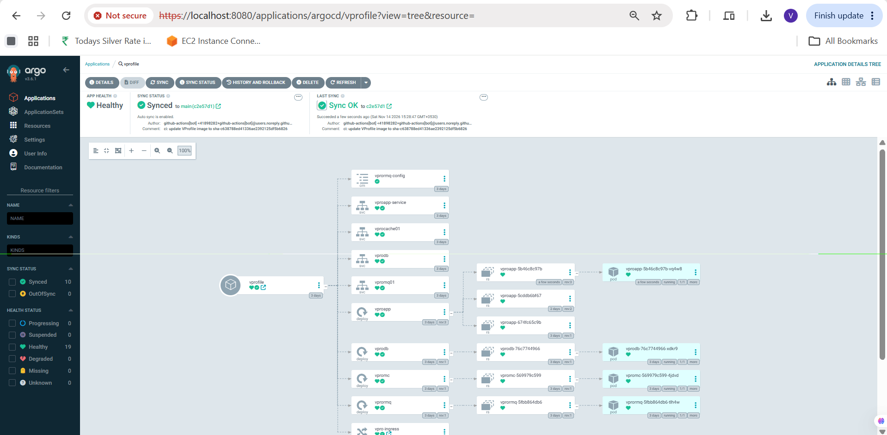
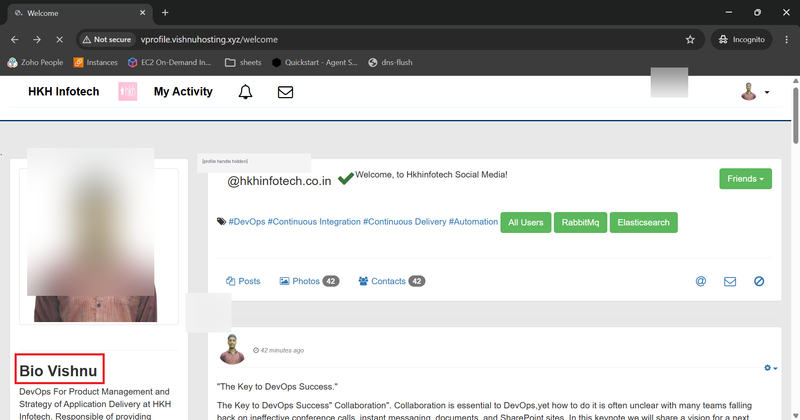
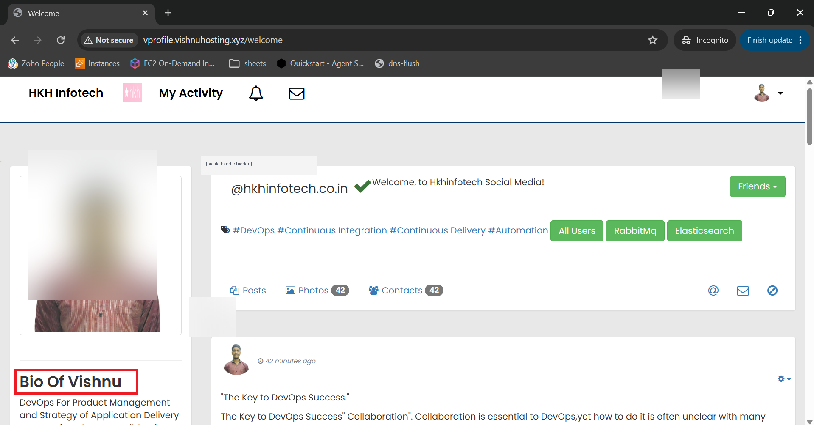

# Phase 6 - Argo CD GitOps and Kubernetes Application Deployment

> **Project:** VProfile EKS GitOps  |  **Region:** `ap-southeast-2`  |  **Application:** `vprofile`  
> **Source of truth for evidence:** User-uploaded `Untitled document (6).pdf`, 12 pages, November 14, 2026. Screenshots and selected terminal output are extracted or transcribed from that PDF.  
> **Scope:** Installation context, declarative Application, Auto Sync, an end-to-end page change, Kubernetes resource verification, and operational troubleshooting.

[Project overview](../../README.md) · [Argo CD folder](../../argocd/README.md) · [Previous phase - CI/CD](../ci-cd/README.md) · [Recorded terminal output](outputs/verified-phase6-output.txt)

## 1. Goal and demonstrable result

This phase establishes **GitOps continuous delivery** for the existing EKS cluster: GitHub Actions produces a Docker image and updates the Helm image tag in Git; Argo CD detects the changed desired state and reconciles the Kubernetes resources. The supplied PDF shows an end-to-end UI edit: the source template `src/main/webapp/WEB-INF/views/welcome.jsp` was modified, and the application later displayed **"Bio Of Vishnu"** instead of **"Bio Vishnu"**.

**Observed results, not assumptions:** `kubectl get applications -n argocd` returns `vprofile Synced Healthy`; `kubectl describe application` records `Automated: true`, an operation initiated by `Automated: true`, and a successful sync to configuration commit `c2e57d19...`; all four Kubernetes Deployments are `1/1`; the four Pods are `Running`, `1/1`, zero restarts; the running app image is `sha-c638788...`. The public page shows the updated Bio text. See Sections 6-8.



## 2. Prerequisites

1. `vprofile-eks` exists in `ap-southeast-2` with a Ready managed worker, EKS core add-ons and a healthy NGINX Ingress Controller. See [Phase 2](../eks-cluster/README.md) and [Phase 4](../load-balancing/README.md).
2. A PVC (`db-pv-claim`) with `gp3` storage and the `app-secret` Kubernetes Secret already exist in namespace `default`. See [Phase 3](../persistent-storage/README.md).
3. Published Docker Hub images and a GitHub Actions workflow that writes the chosen application image SHA into `helm/vprofile-chart/values.yaml`. See [Phase 5](../ci-cd/README.md).
4. Ubuntu administration EC2 has valid AWS IAM credentials, `kubectl`, `helm`, and an accessible kubeconfig for the EKS cluster.
5. The Git repository is public or is registered with Argo CD using private-repository credentials. Do not put Git tokens in this README.

## 3. Argo CD installation (reproducible setup)

Argo CD was previously installed using its upstream manifests. The screenshot displays **Argo CD v3.6.1**; the manifest URL below is an explicit pinned version for a reproducible rebuild, not proof that every historical installation command used exactly this version.

```bash
kubectl create namespace argocd
kubectl apply -n argocd --server-side --force-conflicts \
  -f https://raw.githubusercontent.com/argoproj/argo-cd/v3.6.1/manifests/install.yaml
kubectl get pods -n argocd
kubectl wait --for=condition=available deployment --all -n argocd --timeout=300s
```

**Command use:** create an isolated namespace; install Argo CD CRDs and controller workloads; verify running pods; wait for Deployments to become available. The default install contains components such as the API/server, application controller, repo-server, Redis and ApplicationSet controller. Recreating it creates resources and may incur compute cost; do not rerun on a working cluster without need.

### Access the dashboard privately

Keep `argocd-server` as `ClusterIP` and use `kubectl port-forward` from the administration host:

```bash
kubectl -n argocd port-forward svc/argocd-server 8080:443 --address 127.0.0.1
```

From your workstation establish an SSH local tunnel from `localhost:8080` to the EC2 host's `127.0.0.1:8080`, then visit `https://localhost:8080`. Do not expose Argo CD publicly for a demo unless authentication, TLS and network controls are properly configured. To check a port conflict: `sudo ss -lntp | grep ':8080'`.

For an initial installation, retrieve the bootstrap admin password locally (do not commit, screenshot or share its value):

```bash
kubectl -n argocd get secret argocd-initial-admin-secret \
  -o jsonpath='{.data.password}' | base64 -d
```

Change the password and remove the one-time secret once initial access has been secured.

## 4. Register the VProfile Helm Application

The active Application is managed in `argocd/application.yaml` in your actual repository. The following is the **observed configuration** from this evidence; the package includes it as a documentation reference at [`outputs/observed-application-reference.yaml`](outputs/observed-application-reference.yaml), **not as a replacement** for your live file.

```yaml
apiVersion: argoproj.io/v1alpha1
kind: Application
metadata:
  name: vprofile
  namespace: argocd
spec:
  project: default
  source:
    repoURL: https://github.com/Kizhakkekkara-Vishnu-Vijayan/vprofile-eks-gitops.git
    targetRevision: main
    path: helm/vprofile-chart
    helm:
      releaseName: vprofile
  destination:
    server: https://kubernetes.default.svc
    namespace: default
  syncPolicy:
    automated:
      enabled: true
      prune: false
      selfHeal: true
    syncOptions:
      - CreateNamespace=false
```

```bash
kubectl apply -f argocd/application.yaml
kubectl get application vprofile -n argocd
kubectl describe application vprofile -n argocd
```

**Meaning:** `main` is the Git revision Argo CD watches; `helm/vprofile-chart` contains the Helm chart; the release name is `vprofile`; resources deploy to the existing `default` namespace on the same EKS cluster. Argo CD reads Git, **not the EC2 checkout**.

## 5. Why these Auto Sync settings matter

| Configuration | Effect / operational consideration |
| --- | --- |
| `automated.enabled: true` | Reconcile changes committed to the desired state in Git without clicking Sync. |
| `automated.selfHeal: true` | Reconcile drift caused by manually editing live Kubernetes resources. Test edits can be overwritten. |
| `automated.prune: false` | Do **not** automatically delete resources removed from Git. They may remain and require an intentional cleanup. |
| `CreateNamespace=false` | The namespace must exist before synchronization. In this project, `default` already exists. |

Because Auto Sync is enabled, prefer modifying the source of truth and pushing a Git commit. Avoid manual image changes to Kubernetes Deployments: self-healing can restore Git's desired configuration.

**Important nuance:** automated reconciliation can transition through `OutOfSync` and `Progressing` during a healthy rollout. The supplied event logs explicitly show both transitions. "Synced" alone does not prove the site is usable; also check Deployment availability and browser functionality.

## 6. Real change test - GitHub commit through Argo CD to browser

### 6.1 Source edit and CI trigger

The screenshot shows an edit to `src/main/webapp/WEB-INF/views/welcome.jsp` committed directly to `main` with the message `Update welcome.jsp` and the description *Changing the Bio section for github actions trigger*.



The Actions page in the evidence shows the VProfile workflow runs. This is **run-list evidence**, not expanded build-test-push logs for this exact latest commit; detailed CI job evidence is documented separately in [Phase 5](../ci-cd/README.md).



### 6.2 Argo CD status transitions

The screenshot of the terminal watch displays `OutOfSync` and `Progressing` values before returning to `Synced / Healthy`. This is expected when a new Deployment image rolls out.



The actual `kubectl describe application vprofile -n argocd` log contains:

```text
History id 3: automated sync to GitOps revision c2e57d19d6dfcf68f005a2901d181da96096b9da
Operation: successfully synced (all tasks run)
Events: Synced -> OutOfSync -> Synced
Events: Healthy -> Progressing -> Healthy
```

The new source image was:

```text
docvishnu1/vprofileapp:sha-c638788ed41336ae2392125df5b6826ae86e6d66
```

**Commit distinction:** the GitOps revision `c2e57d19...` records the Helm configuration that Argo CD synchronized. The image tag `sha-c638788...` refers to the source revision used in the application image build. These are expected to differ.

### 6.3 Before/after resource visualization

The screenshots show the Application summary and resource graph. The screenshot pair documents the requested visual evidence of the resource tree.





### 6.4 Website before and after

The application page at `http://vprofile.vishnuhosting.xyz/welcome` displays the updated title. Personal/profile photos in the public-repository screenshots have been blurred; the title change remains readable.

**Before:**



**After:**



This is useful evidence of frontend content updating through GitOps. It is **not** proof of every backend business flow or HTTPS configuration; the browser screenshot shows an HTTP/"Not secure" context.

## 7. Kubernetes resources actually observed

The PDF's `kubectl describe application` output lists **10 direct Argo CD managed resources**: 1 ConfigMap (`vprormq-config`), 4 ClusterIP Services (`vproapp-service`, `vprocache01`, `vprodb`, `vpromq01`), 4 Deployments (`vproapp`, `vprodb`, `vpromc`, `vprormq`) and 1 Ingress (`vpro-ingress`). The ReplicaSets/Pods are descendants managed by Kubernetes Controllers; they are visible in the Argo CD tree but are not extra direct Helm templates.

```text
$ kubectl get deployments -n default
NAME      READY   UP-TO-DATE   AVAILABLE
vproapp   1/1     1            1
vprodb    1/1     1            1
vpromc    1/1     1            1
vprormq   1/1     1            1

$ kubectl get pods -o wide
vproapp-5b46c8c97b-vq4w8   1/1 Running   0 restarts
vprodb-76c7744966-xdkr9    1/1 Running   0 restarts
vpromc-569979c599-4jdvd    1/1 Running   0 restarts
vprormq-5fbb864db6-tlh4w   1/1 Running   0 restarts
```

| Resource | Exposed port / purpose |
| --- | --- |
| `vproapp-service` | 8080/TCP, internal Tomcat Service |
| `vprodb` | 3306/TCP, internal MySQL Service |
| `vprocache01` | 11211/TCP, internal Memcached Service |
| `vpromq01` | 5672/TCP, internal RabbitMQ Service |
| `vpro-ingress` | Host `vprofile.vishnuhosting.xyz`, class `nginx`, currently HTTP 80 in evidence |

At the time of the screenshot, `kubectl top nodes` showed **114m CPU (5%)** and **2,360 MiB memory (75%)** on the single EKS managed worker. These are point-in-time measurements, not guaranteed resource usage. With a single 4 GiB worker, treat memory capacity as an important lab constraint.

## 8. Verification commands for a new engineer

Run this read-only checklist on the EC2 admin host (after confirming `kubectl config current-context` points to the correct EKS cluster):

```bash
kubectl get pods -n argocd
kubectl get applications -n argocd
kubectl get application vprofile -n argocd -o jsonpath='{.spec.syncPolicy.automated}{"\n"}'
kubectl describe application vprofile -n argocd
kubectl get deployments -n default
kubectl get pods -n default -o wide
kubectl get svc -n default
kubectl get ingress -n default
kubectl get deployment vproapp -n default -o jsonpath='{.spec.template.spec.containers[0].image}{"\n"}'
kubectl top nodes
```

Interpret results in order: `Synced` confirms desired/live manifests match, `Healthy` indicates Argo CD's resource health checks, `1/1 Available` confirms Deployments meet replica counts, and the HTTP page verifies application behavior. The `argocd/application.yaml` file must be committed to Git to remain reproducible.

## 9. Troubleshooting (documented failure modes and actionable checks)

| Symptom | First check | Meaning / correction |
| --- | --- | --- |
| No application appears | `kubectl get applications -n argocd` | The Application CR must exist; apply the file after Argo CD CRDs are installed. |
| `OutOfSync / Missing` | `kubectl describe application vprofile -n argocd` | Expected before initial sync; check repository path, destination and permissions if persistent. |
| App stays `Progressing` | `kubectl get pods -o wide`; `kubectl describe pod <name>` | Possible image pull failure, insufficient memory, DB init, or readiness failure. |
| Tag in deployment is old | Compare Helm Git tag and Deployment image | Argo CD must read the Helm bot commit; check Sync Policy, repository access and automated sync history. |
| 404 from NGINX | `kubectl describe ingress vpro-ingress`; `kubectl get endpointslices` | Check host matching, backend Service and endpoints. |
| Argo CD UI unreachable on localhost | `sudo ss -lntp | grep :8080`; SSH tunnel state | Port forwarding runs on EC2, not your local PC. Ensure SSH tunnel and `kubectl port-forward` are both connected. |
| `Not secure` in browser | Check Ingress and TLS | This evidence uses HTTP only; add valid HTTPS before real credentials. |
| Auto Sync overwrites manual changes | `kubectl get application vprofile -n argocd -o yaml` | With `selfHeal: true`, change Git/Helm instead of live resources. |

## 10. What is and is not verified by the PDF

**Verified:** source change shown; workflow history screenshot; Argo CD v3.6.1 UI; automated sync enabled; successful automated reconcile recorded; 4/4 Deployments available; 4/4 Pods ready; correct app image tag in the Deployment; four internal Services; NGINX host-based Ingress; browser before/after Bio update.

**Not directly proved by this Phase 6 PDF:** the expanded Maven test logs for the newest commit; a second current cluster audit; production-grade authentication, HTTPS/TLS, multiple availability zones for application resilience or durable backup/restore. Evidence in other phase chapters covers infrastructure components but does not turn this single-worker lab into a production-grade HA deployment.

## 11. Phase 7 hand-off

Next chapter: DNS ownership/delegation, GoDaddy CNAME pointing at the Sydney NLB, `dig` authoritative vs recursive resolution, public `curl` HTTP response, and browser login/changed welcome page. Capture GoDaddy DNS settings (mask unrelated records), `dig +short NS/CNAME`, `curl -i http://vprofile.vishnuhosting.xyz` (omit cookies or sensitive headers), and screenshot the public browser without publishing credentials.
