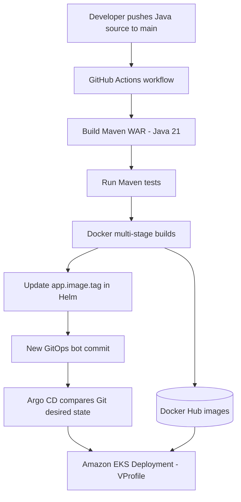
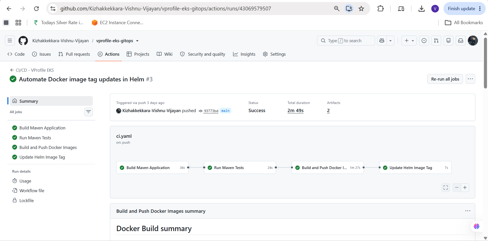
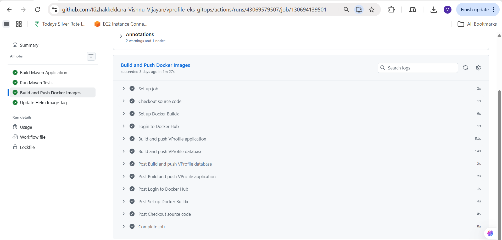
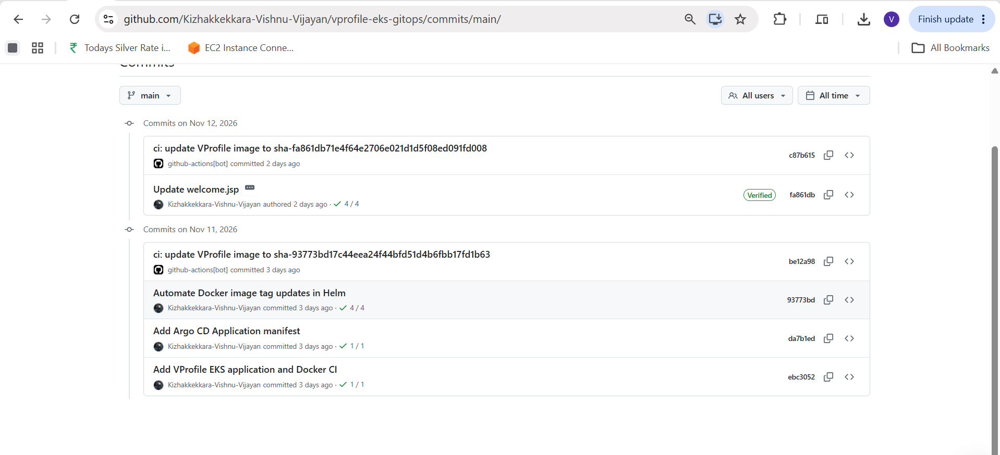
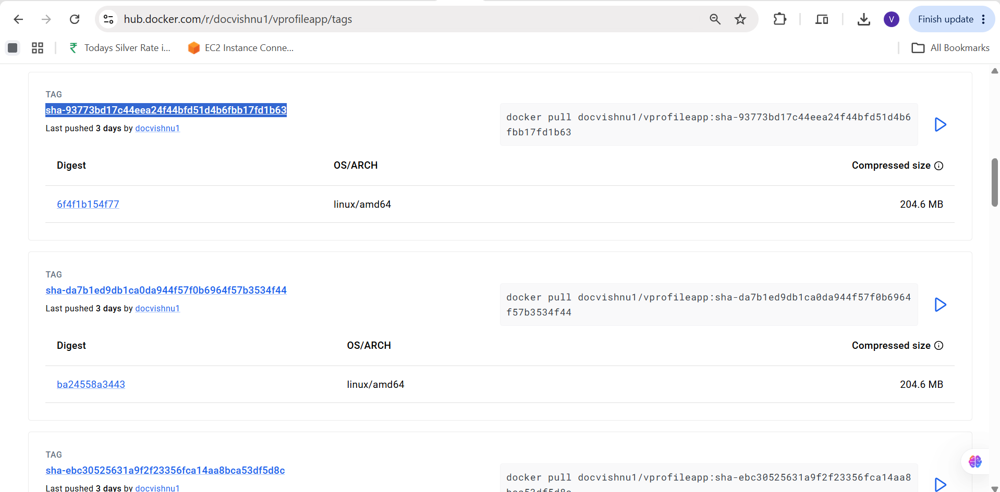
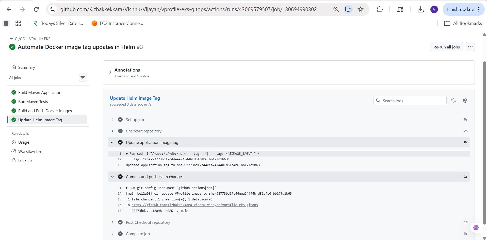

# Phase 5 - Docker Containerization and GitHub Actions CI/CD

> **Project:** VProfile EKS GitOps | **Region:** `ap-southeast-2` | **GitHub:** [`Kizhakkekkara-Vishnu-Vijayan/vprofile-eks-gitops`](https://github.com/Kizhakkekkara-Vishnu-Vijayan/vprofile-eks-gitops)  
> **Evidence source:** Uploaded eight-page `Untitled document (4).pdf` (November 2026). The screenshots and the terminal output below were taken from that PDF.  
> **Scope:** This chapter describes **CI and image publication**, followed by the Helm tag that Argo CD uses for deployment. Phase 6 covers Argo CD itself.

[← Project overview](../../README.md) | [← Phase 4: NLB + NGINX](../load-balancing/README.md) | [Dockerfiles overview](../../Docker-files/README.md) | [Workflow overview](../../.github/workflows/README.md)

## 1. Purpose

The objective is to automatically package the Java VProfile application, run tests, produce Docker images, publish them to Docker Hub, and record the new application tag in Git. **Argo CD subsequently reads that Git change** and synchronizes Kubernetes resources when a sync is requested or automated sync is enabled.



**Separation of responsibilities:** A Git *source commit* identifies the revision used to build an image. A later *GitOps commit* changes `values.yaml` to reference that image. They are usually not the same commit.

## 2. Actual results evidenced in your PDF

| Item | Actual evidence | Source |
| --- | --- | --- |
| CI execution | **Workflow #3 succeeded** in **2m49s** for source commit **`93773bd`** | [Four-job overview](screenshots/github-actions-four-stage-success.png), source PDF p.1 |
| Maven Build | Job succeeded (36 seconds shown) | [Four-job overview](screenshots/github-actions-four-stage-success.png) |
| Maven Test | Job succeeded (24 seconds shown) | [Four-job overview](screenshots/github-actions-four-stage-success.png) |
| Docker Build + Push | Job succeeded (1m27s); application and DB image push steps have checkmarks | [Docker job](screenshots/github-actions-docker-build-job.png) |
| Helm image update | Job succeeded (7 seconds); wrote `sha-93773bd17c44eea24f44bfd51d4b6fbb17fd1b63` and pushed bot commit **`be12a98`** | [Helm update logs](screenshots/github-actions-helm-update-commit.png) |
| Docker Hub repository | At least three commit-tagged application images visible; `sha-93773bd...` is one of them | [Docker Hub tags](screenshots/docker-hub-vprofileapp-sha-tags.png) |
| Later source modification | Source commit **`fa861db`** has message **`Update welcome.jsp`** | Source PDF p.8 transcript |
| Later automatic Helm commit | **`c87b615`** changed Helm tag to `sha-fa861db71e4f64e2706e021d1d5f08ed091fd008` | Source PDF p.8 transcript |
| Current deployment image at time of capture | EKS Deployment `vproapp` references **`docvishnu1/vprofileapp:sha-fa861db71e4f64e2706e021d1d5f08ed091fd008`** | Source PDF p.8 transcript |

> **Evidence boundary:** The PDF contains a Docker Hub screenshot for the **application**, not a separate Docker Hub database `bootstrap` tag screenshot. Its green CI job indicates the DB build-and-push step completed, but a separate DB repository screenshot would be valuable as additional evidence. The PDF also does **not** contain the expanded Maven unit-test report.

### 2.1 Four jobs succeeded



The screenshot confirms the job dependency chain: **Build Maven Application → Run Maven Tests → Build and Push Docker Images → Update Helm Image Tag**. Each successive stage runs only after its prerequisite succeeds.

### 2.2 The Docker publish job



The expanded job shows checkout, Docker Buildx, Docker Hub login, application image publish, and database image publish. The screenshot shows successful step statuses, but not the detailed `docker build` layer output itself.

## 3. Repository files and prerequisites

The existing project contains the actual executable files. Link to them instead of maintaining potentially inconsistent copies:

| File | Responsibility |
| --- | --- |
| [`pom.xml`](../../pom.xml) | Maven dependencies and WAR build; source in this project targets Java 17 bytecode |
| [`src/`](../../src/) | Java, web views, resource files and tests |
| [`Docker-files/app/Dockerfile`](../../Docker-files/app/Dockerfile) | Maven build stage and Tomcat runtime stage |
| [`Docker-files/db/Dockerfile`](../../Docker-files/db/Dockerfile) | MySQL 8 image with initialization SQL |
| [`Docker-files/db/db_backup.sql`](../../Docker-files/db/db_backup.sql) | Database initialization script (do not publish live data or passwords) |
| [`.github/workflows/ci.yaml`](../../.github/workflows/ci.yaml) | Actual four-job CI workflow |
| [`helm/vprofile-chart/values.yaml`](../../helm/vprofile-chart/values.yaml) | The deployment image tag stored in Git |

**Prerequisites for recreating the pipeline:** a public or accessible GitHub repository, GitHub Actions enabled, Docker Hub repositories `docvishnu1/vprofileapp` and `docvishnu1/vprofiledb`, and repository Actions secrets `DOCKERHUB_USERNAME` and `DOCKERHUB_TOKEN`. For a bot commit using GitHub's built-in token, workflow permissions must allow `contents: write`, subject to branch protection and organization policies.

**Never commit** Docker Hub access tokens, GitHub PATs, AWS credentials, Kubernetes Secret values, or `.pem` keys. Existing credentials should be kept in GitHub encrypted secrets or Kubernetes Secret resources as appropriate.

## 4. Application Dockerfile: two-stage packaging

The uploaded Dockerfile references **Maven 3.9.13 with Temurin JDK 21** for compiling and **Tomcat 10.1 with JRE 21** for the running application.



Relevant build instructions from the supplied source:

```dockerfile
FROM maven:3.9.13-eclipse-temurin-21 AS BUILD_IMAGE
WORKDIR /app
COPY pom.xml .
COPY src ./src
RUN mvn -B -DskipTests clean package

FROM tomcat:10.1-jre21-temurin
RUN rm -rf /usr/local/tomcat/webapps/*
COPY --from=BUILD_IMAGE /app/target/*.war /usr/local/tomcat/webapps/ROOT.war
EXPOSE 8080
CMD ["catalina.sh", "run"]
```

**Command breakdown**

- `FROM maven:... AS BUILD_IMAGE`: starts a disposable build environment with Java and Maven.
- `COPY pom.xml .` and `COPY src ./src`: build the **checked-out commit**, not a different Git repository cloned within Docker.
- `mvn -B -DskipTests clean package`: compiles/packages the WAR; tests are handled by a **separate CI job** beforehand.
- `FROM tomcat:...`: creates the runtime stage; Maven is **not** installed in the final runtime container.
- `ROOT.war`: deploys application at URL `/`, consistent with NGINX host routing.
- `EXPOSE 8080`: documents the Tomcat port. It doesn't publish a host port on its own.

**Important:** `Dockerfile` imports a WAR via `target/*.war`; the build must produce the expected single WAR. The application uses `jakarta.servlet` imports; Tomcat 10.1 is Jakarta-based. A successful build is evidence the container build worked, not proof every functional application feature passed testing.

## 5. Database image and its initialization

The observed database Dockerfile (from the PDF and previously recorded implementation) uses `mysql:8.0`, sets `MYSQL_DATABASE=accounts` and `MYSQL_ROOT_HOST=%`, copies `db_backup.sql` to `/docker-entrypoint-initdb.d/01-db_backup.sql`, and starts MySQL with small lab-oriented memory settings. The image is published as **`docvishnu1/vprofiledb:bootstrap`**.

- `MYSQL_ROOT_PASSWORD` comes from Kubernetes `app-secret`, not from the newly authored Dockerfile.
- The initialization SQL normally runs **only when the MySQL data directory is empty**. Redeploying the image against the existing Bound PVC will not automatically rerun the dump.
- `MYSQL_ROOT_HOST=%` permits root connections from other hosts; it is a demo-only tradeoff and should be replaced by a restricted application database user in production.
- The workflow rebuilds the DB image on every eligible code commit; that is functional but unnecessary for Java-only changes. A future change-filtered database job could reduce unnecessary builds.

For the actual file, refer to [`Docker-files/db/Dockerfile`](../../Docker-files/db/Dockerfile).

## 6. GitHub Actions CI workflow: what each stage does

The file in the evidence is named **`.github/workflows/ci.yaml`** and has these four jobs. Do not paste the code block below into a new file if the workflow already exists in your repository.

### Stage 1 - Build Maven Application

```yaml
build:
  runs-on: ubuntu-latest
  steps:
    - uses: actions/checkout@v4
    - uses: actions/setup-java@v4
      with:
        distribution: temurin
        java-version: '21'
        cache: maven
    - run: mvn -B -ntp -DskipTests clean package
```

**Meaning:** Ensures the Maven project packages into a WAR. `-ntp` disables Maven transfer progress; `-DskipTests` means this job is about packaging, not test success.

### Stage 2 - Run Maven Tests

```yaml
test:
  needs: build
  runs-on: ubuntu-latest
  steps:
    - uses: actions/checkout@v4
    - uses: actions/setup-java@v4
      with:
        distribution: temurin
        java-version: '21'
        cache: maven
    - run: mvn -B -ntp test
```

**Meaning:** Runs the project's Maven tests and gates the Docker job. The screenshot shows this job succeeded for run #3; it does not show test counts or assertions.

### Stage 3 - Build and Push Docker Images

```yaml
docker:
  needs: test
  runs-on: ubuntu-latest
  steps:
    - uses: actions/checkout@v4
    - uses: docker/setup-buildx-action@v3
    - uses: docker/login-action@v3
      with:
        username: ${{ secrets.DOCKERHUB_USERNAME }}
        password: ${{ secrets.DOCKERHUB_TOKEN }}
    - uses: docker/build-push-action@v6
      with:
        context: .
        file: ./Docker-files/app/Dockerfile
        push: true
        tags: |
          docvishnu1/vprofileapp:sha-${{ github.sha }}
          docvishnu1/vprofileapp:latest
    - uses: docker/build-push-action@v6
      with:
        context: ./Docker-files/db
        file: ./Docker-files/db/Dockerfile
        push: true
        tags: docvishnu1/vprofiledb:bootstrap
```

**Meaning:** Authentication to Docker Hub is through GitHub Secrets. The app's image receives a **source commit SHA tag** and `latest`, while the database image uses the rolling `bootstrap` tag. The app build uses repository root (`context: .`) because its Dockerfile copies `pom.xml` and `src/`; the DB build uses `Docker-files/db` because the SQL lives there.



**Interpretation:** The Docker Hub screenshot lists images tagged from source commits such as `93773bd...` and earlier builds. The visible digest abbreviations are **OCI image digests**, not Git source commit hashes. For byte-for-byte deployment pinning, an OCI digest is stronger than a mutable tag.

### Stage 4 - Update Helm Image Tag

```yaml
update-helm:
  needs: docker
  runs-on: ubuntu-latest
  steps:
    - uses: actions/checkout@v4
      with:
        ref: main
        fetch-depth: 0
    - name: Update application image tag
      env:
        IMAGE_TAG: sha-${{ github.sha }}
      run: |
        sed -i "/^app:/,/^db:/ s|^    tag: .*|    tag: \"$IMAGE_TAG\"|" \
          helm/vprofile-chart/values.yaml
    - name: Commit and push Helm change
      run: |
        git config user.name "github-actions[bot]"
        git config user.email "41898282+github-actions[bot]@users.noreply.github.com"
        git add helm/vprofile-chart/values.yaml
        if git diff --cached --quiet; then
          echo "No Helm image tag change required."
        else
          git commit -m "ci: update VProfile image to sha-${GITHUB_SHA}"
          git push origin HEAD:main
        fi
```

**Meaning:** After the Docker job succeeds, the pipeline records the new **application** tag in Helm and pushes a new Git commit. It does **not** change `db.image.tag`. It relies on `permissions: contents: write` and a branch allowing this commit. The workflow screenshot shows the bot committed `be12a98` after running on source commit `93773bd`.



## 7. Commit lineage: why Argo CD Git SHA and Docker SHA differ

Two real sequences are shown in the supplied evidence:

```text
FIRST SHOWN CI EXECUTION
93773bd  developer commit: Automate Docker image tag updates in Helm
    | GitHub Actions builds from 93773bd
    v
Docker Hub: docvishnu1/vprofileapp:sha-93773bd17c44eea24f44bfd51d4b6fbb17fd1b63
    |
    v
be12a98  GitHub Actions bot commits the new Helm tag

SUBSEQUENT DEPLOYMENT (PDF p.8)
fa861db  developer commit: Update welcome.jsp
    | CI builds from fa861db
    v
Docker Hub tag: sha-fa861db71e4f64e2706e021d1d5f08ed091fd008
    |
    v
c87b615  GitHub Actions bot updates Helm values.yaml
    |
    v
EKS Deployment image: docvishnu1/vprofileapp:sha-fa861db71e4f64e2706e021d1d5f08ed091fd008
```

GitHub uses the first seven characters to abbreviate a commit, for example `93773bd`. GitHub Actions `${{ github.sha }}` uses the complete Git commit SHA. The `sha-` prefix on Docker Hub is a **label convention**, not a different hash algorithm.

The **Argo CD synchronization revision** is the Git revision containing the latest desired Helm configuration. The **Docker tag** identifies the source revision used to build the deployed application. A difference is normal.

## 8. Actual terminal verification recorded in the PDF

The captured transcript on page 8 shows:

```text
$ git log -5 --oneline
c87b615 (HEAD -> main, origin/main) ci: update VProfile image to sha-fa861db71e4f64e2706e021d1d5f08ed091fd008
fa861db Update welcome.jsp
be12a98 ci: update VProfile image to sha-93773bd17c44eea24f44bfd51d4b6fbb17fd1b63
93773bd Automate Docker image tag updates in Helm
da7b1ed Add Argo CD Application manifest

$ grep -A 5 '^app:' helm/vprofile-chart/values.yaml
app:
  replicas: 1
  image:
    repository: docvishnu1/vprofileapp
    tag: "sha-fa861db71e4f64e2706e021d1d5f08ed091fd008"
    pullPolicy: IfNotPresent

$ kubectl get deployment vproapp -o jsonpath='{.spec.template.spec.containers[0].image}{"\n"}'
docvishnu1/vprofileapp:sha-fa861db71e4f64e2706e021d1d5f08ed091fd008
```

The full cleaned excerpt is in [outputs/verified-phase5-terminal.txt](outputs/verified-phase5-terminal.txt).

## 9. Verification commands you can repeat on the administration EC2

```bash
cd /home/ubuntu/vprofile-eks-gitops

git pull --ff-only origin main
git log -5 --oneline

grep -A 5 '^app:' helm/vprofile-chart/values.yaml
kubectl get deployment vproapp \
  -o jsonpath='{.spec.template.spec.containers[0].image}{"\n"}'

kubectl get application vprofile -n argocd \
  -o jsonpath='{.status.sync.status}{" | "}{.status.health.status}{"\n"}'
```

**How to interpret:** The full SHA in the app Deployment image should match the desired tag in Helm if Argo CD has synchronized that revision. `Synced` refers to the desired/live Kubernetes resources, **not** to the latest source commit automatically. An application may be `OutOfSync` if CI has committed new Helm values but automatic Argo CD sync is disabled.

You can also inspect GitHub Actions run logs under the repository's **Actions** tab and Docker Hub tags under `docvishnu1/vprofileapp` and `docvishnu1/vprofiledb`.

## 10. Workflow trigger filters: documentation-only changes

The **uploaded current workflow** ignores these paths on `push` to `main`:

```yaml
paths-ignore:
  - 'helm/**'
  - 'kubedefs/**'
  - 'bootstrap/**'
  - 'argocd/**'
  - 'eks/**'
  # - 'README.md'   # This line was commented out in the uploaded version
```

**Recommended documentation-only change** in the live workflow file:

```yaml
paths-ignore:
  - 'helm/**'
  - 'kubedefs/**'
  - 'bootstrap/**'
  - 'argocd/**'
  - 'eks/**'
  - 'README.md'
  - 'docs/**'
  - 'Docker-files/README.md'
  - '.github/workflows/README.md'
```

The commented `README.md` entry means changing the root README alone **currently may trigger a build**. The supplied workflow also does not exclude new `docs/**` files. GitHub Actions runs a `paths-ignore` filtered workflow when a push includes at least one changed file that does **not** match an ignored pattern. Changes to `.github/workflows/ci.yaml` should still run CI, which is appropriate for testing workflow changes. `kubedefs/**` is a leftover from the previous project and can be removed if that directory does not exist.

**Do not replace the whole workflow only to apply this change.** Edit the filter in the existing `.github/workflows/ci.yaml` and verify the YAML indentation. If any changes to docs and Java code share a commit, CI should still run.

## 11. Common problems and what to check

| Symptom | First check | Action |
| --- | --- | --- |
| Workflow did not start | `paths-ignore`, branch and GitHub Actions enablement | Confirm commit includes a nonignored file |
| Maven fails | Build job compiler/dependency logs | Match `pom.xml` Java target and dependencies |
| Test fails | `Run Maven Tests` output | Fix tests rather than bypassing them silently |
| Docker Hub login fails | Repository secrets and token push permissions | Confirm `DOCKERHUB_USERNAME` / `DOCKERHUB_TOKEN`, do not expose values |
| `COPY pom.xml` fails | Docker build context | Application must build with `context: .` |
| DB init script not rerun | Existing MySQL PVC | Initialization runs only for an empty DB directory; never delete the PVC to force a rerun without a backup |
| Helm bot push fails with 403 | `contents: write` and branch policies | Review repository workflow permissions and protection rules |
| Image updated in Git but not EKS | Argo CD manual sync or failed sync | Refresh and inspect Argo CD Application status |
| Image tag and bot commit SHA differ | Two distinct Git revisions | Use the commit lineage section above |
| Container pulls old image | Tag and `imagePullPolicy`, Kubernetes rollout | Prefer immutable commit-specific tags; inspect Deployment spec and Pod image ID |

## 12. Security and reproducibility notes

- Use GitHub Secrets; do not commit access tokens or passwords.
- `latest` and `bootstrap` tags are mutable. Use a full source SHA tag for traceability; pin by OCI image digest for stronger reproducibility.
- The GitHub Actions run may rebuild the same source revision with newer base images or Maven dependencies if not pinned; that can change image bytes even with the same source commit.
- The workflow currently builds the DB image on every eligible push; split jobs by changed paths if this becomes costly.
- Use branch protections and reviewed PRs for production deployments. This remains a **demonstration lab**.
- **Evidence still needed for a fully illustrated Phase 5:** Docker Hub screenshot for `vprofiledb:bootstrap` and, optionally, the expanded Docker push manifest/output and Maven test totals. The provided screenshots already prove successful workflow job statuses.

## 13. Phase 5 acceptance checklist

- [x] Successful four-job GitHub Actions workflow captured
- [x] Application and database Docker publish steps show success
- [x] Docker Hub application SHA tag captured
- [x] Helm update bot commit captured (`be12a98`)
- [x] Later source commit and Helm bot commit recorded (`fa861db` → `c87b615`)
- [x] Helm tag and actual EKS Deployment image match in terminal output
- [ ] Separate Docker Hub screenshot of `vprofiledb:bootstrap` (optional evidence gap)
- [ ] Detailed Maven test-case totals (optional evidence gap)

**Next:** [Phase 6 - Argo CD synchronization and Kubernetes workload verification](../argocd/README.md) (to be prepared using the Phase 6 evidence upload).
