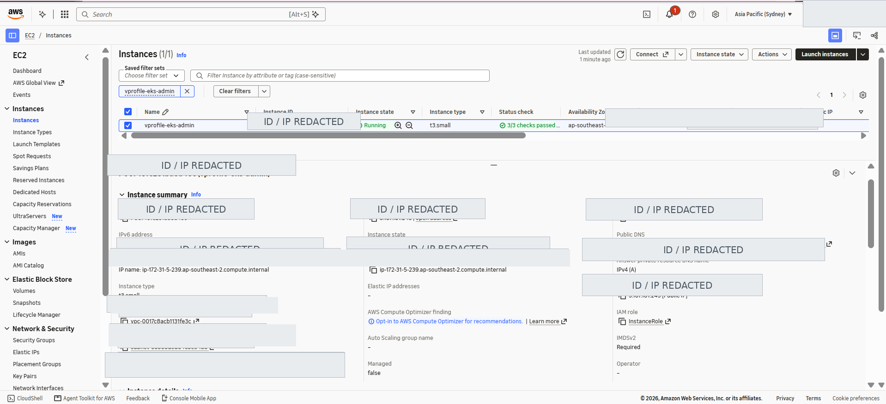
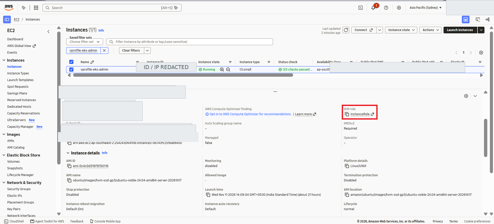
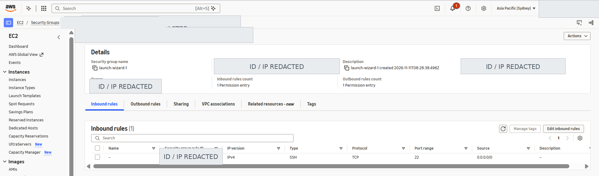
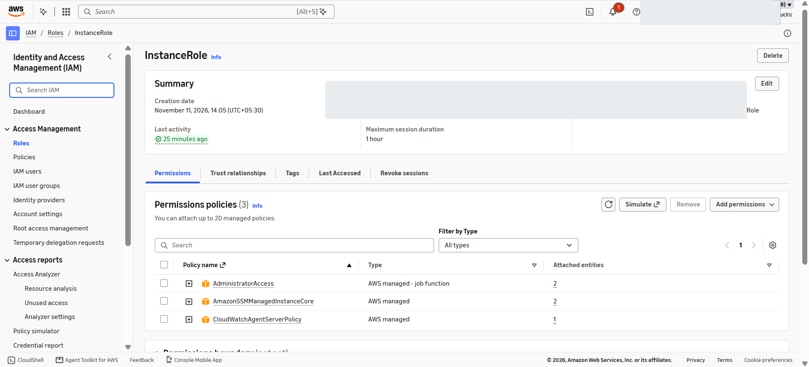

# Phase 01 - Kubernetes Administration EC2 (Ubuntu 24.04)

> **Status:** Implemented and verified in the new AWS account on 11-12 November 2026.  
> **Evidence:** AWS Console screenshots and terminal outputs supplied for this phase. Screenshots in this public documentation pack have account identifiers, addresses and resource IDs masked.  
> **Scope:** An EC2 workstation for running `aws`, `eksctl`, `kubectl`, Helm and Git. **This EC2 is not the EKS control plane or an EKS worker.**

[Back to documentation index](../../README.md) | [Actual bootstrap script](./userdata.sh) | [Tool verification output](./outputs/verified-tool-versions.txt)

## Objective

Create an Ubuntu instance to administer an Amazon EKS cluster in **`ap-southeast-2` (Sydney)**. Install the required CLI tools automatically at first boot using EC2 User Data; avoid manually installing Java, Maven or Docker on this administration instance, because the Java application will later build inside GitHub Actions/Docker.

## Architecture and what was observed

| Item | Observed configuration |
| --- | --- |
| EC2 instance Name tag | `vprofile-eks-admin` |
| Operating system | Ubuntu 24.04.5 LTS, x86_64 |
| AWS Region / AZ | `ap-southeast-2` / `ap-southeast-2a` |
| Instance family | `t3.small` |
| EC2 state | `Running`; 3/3 status checks passed |
| Networking | Default VPC administration instance, public IPv4 enabled; address redacted |
| IAM instance profile/role | `InstanceRole` |
| IMDS | IMDSv2 required |
| Security group | `launch-wizard-1`; inbound SSH/TCP 22 shown as `0.0.0.0/0` (lab configuration - improve for new deployment) |
| Policies attached to role | `AdministratorAccess`, `AmazonSSMManagedInstanceCore`, `CloudWatchAgentServerPolicy` |



*Figure 1: EC2 instance `Running`, 3/3 checks passed, `t3.small` in Sydney. IDs and IPs are hidden for public publication.*



*Figure 2: `InstanceRole` attached to the administration instance; IMDSv2 required.*

## Step 1 - Launch Ubuntu EC2

In the AWS Console: **EC2 > Instances > Launch instance**.

1. **Name:** `vprofile-eks-admin`.
2. **AMI:** Ubuntu Server 24.04 LTS, 64-bit x86. The actual instance reports Ubuntu 24.04.5 LTS after installation.
3. **Instance type:** `t3.small` (administration only; EKS worker configuration is a separate phase).
4. **Network:** Choose the **default VPC** and an internet-connected subnet in Sydney. Ensure an appropriate route to the internet and a public IPv4 address, or use SSM instead of inbound SSH.
5. **Key pair:** Select or create your own EC2 key. Never commit `.pem` or private keys to GitHub.
6. **Security group:** Allow SSH port 22 **from your known public IP `/32`**, not from anywhere. The evidence screenshot shows the less secure earlier lab setting.
7. **IAM instance profile:** Attach an EC2-trusted role. The lab used `InstanceRole` with `AdministratorAccess` for cluster provisioning, plus SSM and CloudWatch policies. For real environments, use scoped IAM policies instead of administrator access.
8. Expand **Advanced details > User data** and paste the contents of [`userdata.sh`](./userdata.sh) before clicking **Launch instance**.

The User Data script configures CLI tools only: **it does not create EKS infrastructure**.

## Step 2 - Understand the security group



*Figure 3: The historical lab EC2 allowed SSH TCP/22 from anywhere. Do not copy this setting into a production environment.*

The original inbound rule was TCP 22, source `0.0.0.0/0`. For a reproducible but safer lab, prefer **My IP** when configuring the rule, and change it if your client IP changes. AWS Systems Manager Session Manager is an alternative that can avoid inbound SSH altogether.

The screenshot lists only **one inbound** and **one outbound** permission entry; the exact outbound destinations are not visible in the provided evidence, so no outbound rule is asserted here.

## Step 3 - Attach an IAM role (no static keys)



*Figure 4: The EC2 instance profile has three attached policies. The role allows software on the instance to obtain temporary credentials through instance metadata.*

Observed policies:

- `AdministratorAccess` - broad lab-only permissions used to create EKS, node groups and supporting AWS resources.
- `AmazonSSMManagedInstanceCore` - supports SSM managed-instance functionality when prerequisites are met.
- `CloudWatchAgentServerPolicy` - permissions useful when sending telemetry through CloudWatch Agent; installation of that agent is **not established** by the supplied tool list.

Verify the instance identity from inside EC2:

```bash
aws sts get-caller-identity
aws configure get region
```

Expected: an **assumed-role** ARN for your EC2 instance profile and region `ap-southeast-2`. **Mask account IDs, instance IDs, and ARNs before publishing console output.**

## Step 4 - Automatic tool installation with User Data

[**Read the complete User Data shell script**](./userdata.sh). It is transcribed from the supplied PDF, normalized as an executable Bash file. It is not a guarantee that a future run will resolve the same latest software versions; pin releases for repeatability.

The script runs during the first EC2 boot as root via cloud-init. Its operations, in order:

| Command or component | Why it is used |
| --- | --- |
| `set -Eeuo pipefail` | Fail early on errors and unset variables; propagate failures through pipelines. |
| `apt-get update` | Refresh the Ubuntu package index. |
| `apt-get install ...` | Install Git, curl, unzip, jq, certificate tools, text editors and DNS utilities. |
| `aws/install` | Install AWS CLI v2 from the official archive. |
| `sha256sum --check` | Validate the eksctl and kubectl release downloads. |
| `eksctl` | Provision and manage an EKS cluster using a declarative cluster YAML. |
| `kubectl` | Manage Kubernetes resources and inspect pods, nodes, services and events. |
| Helm installer | Install Helm 3 for managing release charts. |
| `aws configure set region ...` | Set the default region for the `ubuntu` CLI user, without storing static keys. |
| `exec > >(tee -a ... ) 2>&1` | Write bootstrapping stdout/stderr to `/var/log/eks-admin-bootstrap.log` for troubleshooting. |
| `trap` | Print bootstrap failure details; remove the temporary installation directory. |

### Reusable User Data

The script lives at [`./userdata.sh`](./userdata.sh), so you can select **View raw** in GitHub and paste the contents into the EC2 launch form. Do not attempt to run it on an already configured instance without reviewing installation steps for idempotency.

## Step 5 - Verify successful installation

Execute on the administration EC2:

```bash
echo '===== OPERATING SYSTEM ====='
cat /etc/os-release
uname -m

echo '===== AWS CLI ====='
aws --version

echo '===== EKSCTL ====='
eksctl version

echo '===== KUBECTL ====='
kubectl version --client

echo '===== HELM ====='
helm version --short

echo '===== GIT ====='
git --version

echo '===== USER DATA STATUS ====='
sudo cloud-init status --long
```

### Actual output captured in this project

```text
Ubuntu 24.04.5 LTS (Noble Numbat)
x86_64
aws-cli/2.40.0
0.231.0                          # eksctl
Client Version: v1.36.6           # kubectl
v3.22.1+gd6c1a0e                 # Helm
git version 2.43.0
status: done                      # cloud-init
extended_status: done
errors: []
recoverable_errors: {}
```

The exact unabridged collected output is preserved in [`outputs/verified-tool-versions.txt`](./outputs/verified-tool-versions.txt). `cloud-init` reported no errors, which confirms its completion state in this captured run. Some other first-boot details can be checked by reading the log.

```bash
sudo cloud-init status --long
sudo tail -n 100 /var/log/cloud-init-output.log
sudo tail -n 100 /var/log/eks-admin-bootstrap.log
sudo cat /var/lib/eks-admin-bootstrap.done
```

`/var/lib/eks-admin-bootstrap.done` should be present if the script reaches its success marker. **The marker and bootstrap log contents were not included in the uploaded PDF**, so this is a follow-up check rather than a confirmed observation.

## Troubleshooting

| Symptom | Check / fix |
| --- | --- |
| `aws: command not found` | Inspect `/var/log/eks-admin-bootstrap.log`; verify `/usr/local/bin/aws`; rerun installation only after resolving the cause. |
| `kubectl` checksum fails | Check that the checksum file contains a digest and re-download the correct binary for `uname -m`; do not ignore mismatches. |
| `eksctl` cannot create resources | Run `aws sts get-caller-identity`; check instance role and organization policies. An explicit SCP deny overrides IAM Allow. |
| `cloud-init` reports errors | Review `/var/log/cloud-init-output.log` and `/var/log/eks-admin-bootstrap.log`. |
| SSH cannot connect | Check EC2 status checks, public routing, key permissions, instance username (`ubuntu`) and the SSH `/32` rule. |
| `kubectl get nodes` fails before cluster creation | Expected: install tools first; EKS cluster provisioning comes in Phase 02. |

## Completion checklist

- [x] Instance launched in Sydney and 3/3 EC2 checks passed (screenshot).
- [x] Instance profile `InstanceRole` attached (screenshot).
- [x] Three IAM role policies visible (screenshot).
- [x] User Data script supplied (PDF), with re-usable shell file in this package.
- [x] AWS CLI, eksctl, kubectl, Helm and Git versions verified (terminal output).
- [x] `cloud-init status --long` reports `done` and no errors.
- [ ] SSH source hardened from `0.0.0.0/0` to a trusted IP range (recommendation; not shown as done).
- [ ] Bootstrap success marker and log excerpt captured (optional supplemental evidence).

**Next:** [Phase 02 - EKS Cluster Creation](../../README.md#phase-02-evidence-needed) documents `eks/cluster.yaml`, `eksctl create cluster`, control-plane creation, the worker node group and `kubectl get nodes -o wide`.
