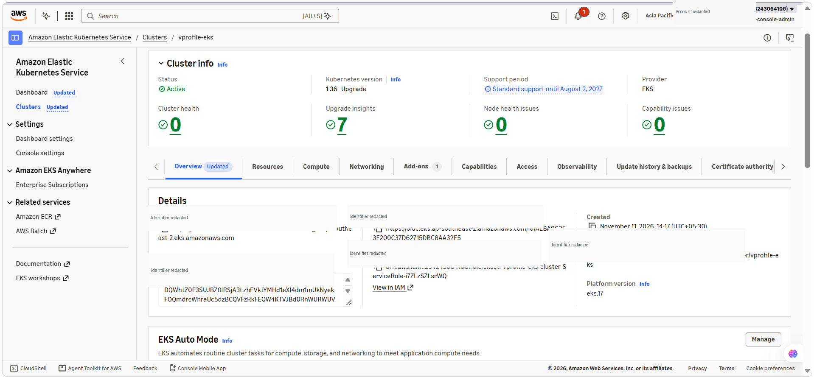
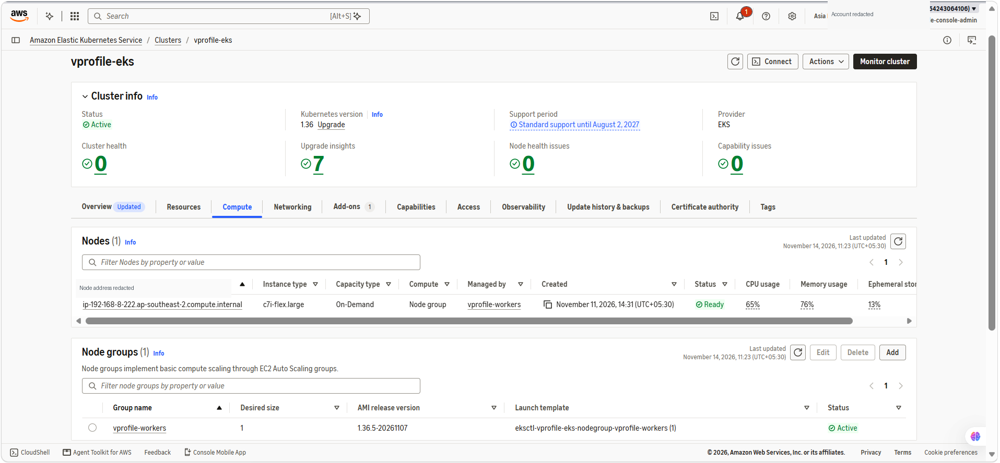
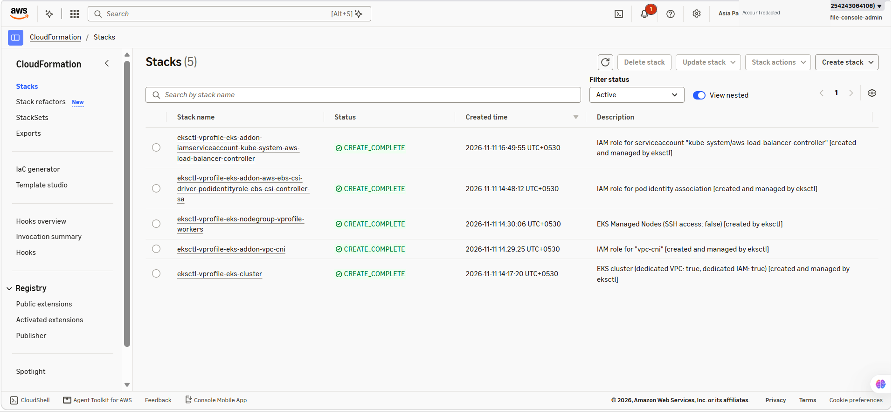
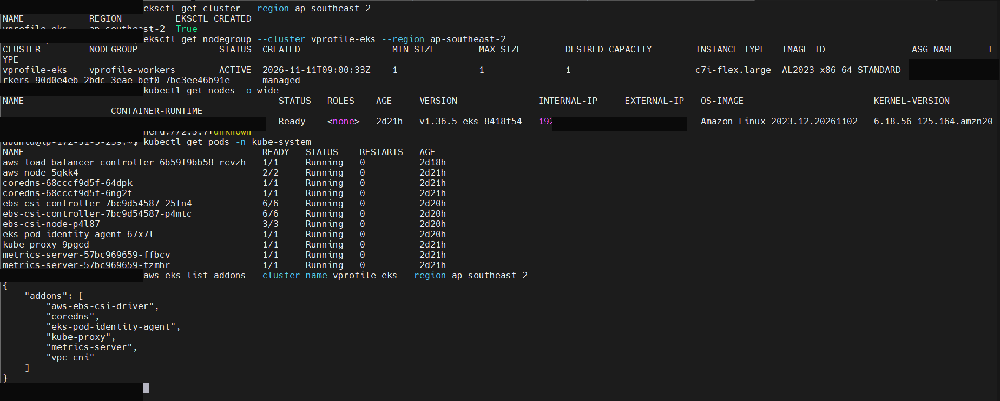

# Phase 02 - Amazon EKS cluster and managed worker node

> **Evidence status:** Cluster creation, worker node and add-ons have been confirmed by the supplied EKS/CloudFormation console screenshots and an `eksctl`/`kubectl` terminal screenshot. The creation log excerpts below were also supplied earlier in this conversation, not in the new two-page PDF.  
> **AWS Region:** `ap-southeast-2` (Sydney)  
> **Public documentation:** Account IDs, addresses, API endpoints, role ARNs and personal console identity have been redacted from screenshots.  
> **Scope boundary:** The separate administration EC2 uses the default VPC. `eksctl` created an EKS-specific VPC for the cluster; the administration EC2 is **not** an EKS worker or control-plane server.

[Back to project documentation](../../README.md) | [Administration EC2 - Phase 01](../ec2-administration/README.md) | [Cluster configuration in repository](../../eks/cluster.yaml) | [Verified output](outputs/cluster-verification.txt)

## Objective

Provision a Kubernetes 1.36 cluster using managed Amazon EKS and a one-node EKS managed node group. Use `eksctl` from the administration EC2, verify access through `kubectl`, and capture the real AWS console evidence. The initial project is a lab configuration: one `c7i-flex.large` worker, one availability zone for the node group and no NAT gateway. The EKS control plane remains AWS-managed.

## Architecture and verified configuration

| Item | Configuration / actual evidence |
| --- | --- |
| Cluster | `vprofile-eks` |
| Region | `ap-southeast-2` (Sydney) |
| Kubernetes version | EKS 1.36; node reports `v1.36.5-eks-8418f54` in supplied terminal evidence |
| Control plane | AWS-managed EKS, `Active` |
| Cluster health indicators | `0` cluster, node-health and capability issues in the supplied console screenshot |
| Worker node group | `vprofile-workers` |
| Node instances | `1` Ready; on-demand EC2 `c7i-flex.large` |
| Desired / minimum / maximum | `1` / `1` / `1` |
| Worker AMI family | Amazon Linux 2023 (AL2023_x86_64_STANDARD) |
| Worker storage | 30 GiB gp3 root volume, per project cluster configuration |
| Networking | EKS-owned VPC, public worker subnet, NAT gateways disabled in project YAML; verify network policy if adapting |
| Cluster endpoint | Public and private access requested in the project configuration |
| Initial cluster add-ons | CoreDNS, kube-proxy, VPC CNI and metrics-server; EBS CSI + Pod Identity were installed after initial creation |
| Later platform components in verification screenshot | AWS Load Balancer Controller and EBS CSI workloads appear Running; **not** part of the initial four baseline add-ons |
| Proof of AWS provisioning | Five `CREATE_COMPLETE` CloudFormation stacks in screenshot captured after add-on setup |



*Figure 1 - Actual EKS console overview: cluster `Active`, Kubernetes 1.36, and no reported cluster/node health issues. Identifying endpoint and IAM details are redacted.*

## Step 1 - Confirm the prerequisites on the administration EC2

**Purpose:** Ensure the CLI calls are made in the correct AWS account and Sydney region. IAM permissions must permit EKS, VPC, EC2, CloudFormation and relevant IAM operations. A service-control-policy explicit deny overrides administrator privileges.

```bash
aws sts get-caller-identity
aws configure get region
aws eks list-clusters --region ap-southeast-2 --output table
aws ec2 describe-instance-type-offerings \
  --region ap-southeast-2 \
  --location-type availability-zone \
  --filters 'Name=location,Values=ap-southeast-2a' \
            'Name=instance-type,Values=c7i-flex.large' \
  --output table
```

**Explanation:** `get-caller-identity` verifies the role in use; `list-clusters` prevents an accidental duplicate; `describe-instance-type-offerings` confirms the instance family is offered in the chosen AZ (not a guarantee of real-time capacity). Do not publish the AWS account ID or assumed-role ARN verbatim.

## Step 2 - Define `eks/cluster.yaml`

The project uses `eksctl` to declare the control plane, EKS-managed worker and network settings. The following is the project reference configuration; **the original exact YAML at creation time is not embedded in the Phase 02 PDF**. Verify the checked-in [`eks/cluster.yaml`](../../eks/cluster.yaml) against your AWS environment before recreating it.

```yaml
apiVersion: eksctl.io/v1alpha5
kind: ClusterConfig
metadata:
  name: vprofile-eks
  region: ap-southeast-2
  version: '1.36'
autoModeConfig:
  enabled: false
availabilityZones:
  - ap-southeast-2a
  - ap-southeast-2b
vpc:
  nat:
    gateway: Disable
  clusterEndpoints:
    publicAccess: true
    privateAccess: true
iam:
  withOIDC: true
managedNodeGroups:
  - name: vprofile-workers
    instanceType: c7i-flex.large
    availabilityZones:
      - ap-southeast-2a
    desiredCapacity: 1
    minSize: 1
    maxSize: 1
    volumeSize: 30
    volumeType: gp3
    privateNetworking: false
    ssh:
      allow: false
```

| YAML key | Why it is used |
| --- | --- |
| `metadata.name`, `region`, `version` | Name the EKS cluster, choose Sydney and select Kubernetes version. |
| `autoModeConfig.enabled: false` | Explicitly use traditional managed node groups rather than EKS Auto Mode (supported by the current `eksctl` project template). |
| `availabilityZones` | Establish a two-AZ network footprint. |
| `vpc.nat.gateway: Disable` | Avoid NAT gateway expense; worker networking must still provide required outbound connectivity. |
| `clusterEndpoints` | Permit API access through both public and private EKS endpoints. Protect public API access with appropriate CIDR restrictions for real environments. |
| `iam.withOIDC` | Requests an IAM OIDC provider for workloads needing service-account role integration. |
| `managedNodeGroups` | Allow EKS to operate the node group and its underlying EC2 Auto Scaling Group. |
| `privateNetworking: false` | Use public subnet networking for these managed workers; do not imply the admin EC2 is in the same VPC. |
| `ssh.allow: false` | Do not open SSH access directly to workers. |

**Lab caution:** With NAT disabled and one public worker, the architecture is inexpensive but lacks multi-worker redundancy. Production designs generally use private workloads, least-privilege IAM, multiple nodes and AZs, and controlled egress.

## Step 3 - Validate the configuration without creating resources

```bash
cd /home/ubuntu/vprofile-eks-gitops

# Check that the selected config file is present.
ls -lh eks/cluster.yaml

# Inspect eksctl's planned configuration before provisioning.
eksctl create cluster -f eks/cluster.yaml --dry-run
```

The creation command was earlier run with `eksctl` 0.231.0. Its dry-run showed a managed node group named `vprofile-workers`, AL2023, a `c7i-flex.large` instance, no NAT gateway and both public/private cluster endpoints. Dry-run is not a proof of AWS provisioning; the AWS screenshots and following verification are.

## Step 4 - Create the EKS cluster

```bash
eksctl create cluster -f eks/cluster.yaml
```

**What happens:** `eksctl` creates CloudFormation stacks for VPC resources and the EKS control plane, provisions baseline EKS add-ons, then creates a managed node group and waits for a worker to become ready.

**Selected real creation-log results from the earlier terminal transcript:**

```text
2026-11-11 08:47:20  creating EKS cluster "vprofile-eks" in "ap-southeast-2" region with managed nodes
2026-11-11 09:03:28  all EKS cluster resources for "vprofile-eks" have been created
2026-11-11 09:03:28  nodegroup "vprofile-workers" has 1 node(s)
2026-11-11 09:03:28  node "ip-..." is ready
2026-11-11 09:03:28  created 1 managed nodegroup(s) in cluster "vprofile-eks"
2026-11-11 09:03:31  EKS cluster "vprofile-eks" in "ap-southeast-2" region is ready
```

This excerpt is abbreviated and redacted; the **attached Phase 02 PDF does not include the full `eksctl create cluster` output**. The CloudFormation image below is independent AWS-side evidence that the resources were created.

## Step 5 - Update your Kubernetes context

```bash
aws eks update-kubeconfig \
  --region ap-southeast-2 \
  --name vprofile-eks

kubectl config current-context
kubectl get nodes -o wide
```

**Important:** If provisioning was done with `sudo`/`root`, kubeconfig may have been written under `/root/.kube/config`; generate a separate config for `ubuntu` by running `aws eks update-kubeconfig` as `ubuntu`. Do not copy raw authentication files into a public repository. Both AWS IAM identity and EKS access permissions must be correct.

## Step 6 - Verify the worker in AWS Console

AWS Console > **EKS > Clusters > vprofile-eks > Compute**.



*Figure 2 - Actual console evidence captured on 14 November 2026: 1 `Ready` worker (`c7i-flex.large`, On-Demand) in the `vprofile-workers` node group; desired 1 and group `Active`. At that snapshot the console displayed ~65% CPU and ~76% memory utilization. Resource use is a point-in-time measurement, not a minimum hardware specification.*

The terminal image independently shows a `Ready` node on Amazon Linux 2023 using `containerd`, with Kubernetes version `v1.36.5-eks-8418f54`. The exact instance IDs and addresses were masked for publication.

## Step 7 - Verify the CloudFormation stacks

AWS Console > **CloudFormation > Stacks** in Sydney.



*Figure 3 - Five visible stacks with status `CREATE_COMPLETE` as of the screenshot. Some stacks were created in later phases (e.g., EBS CSI and AWS Load Balancer Controller), and should not be described as prerequisites of the initial EKS cluster.*

| Stack shown | Role |
| --- | --- |
| `eksctl-vprofile-eks-cluster` | EKS cluster, networking and baseline IAM |
| `eksctl-vprofile-eks-nodegroup-vprofile-workers` | Managed worker node group |
| `eksctl-vprofile-eks-addon-vpc-cni` | IAM resources for VPC CNI |
| `eksctl-vprofile-eks-addon-aws-ebs-csi-driver-podidentityrole-ebs-csi-controller-sa` | EBS CSI controller Pod Identity role; created after core cluster |
| `eksctl-vprofile-eks-addon-iamserviceaccount-kube-system-aws-load-balancer-controller` | AWS Load Balancer Controller IAM service account; created after core cluster |

To list the current CloudFormation stacks in the account:

```bash
aws cloudformation describe-stacks \
  --region ap-southeast-2 \
  --query "Stacks[?contains(StackName, 'eksctl-vprofile-eks')].[StackName,StackStatus]" \
  --output table
```

## Step 8 - Run the same verification commands captured in the terminal



*Figure 4 - Actual terminal command evidence supplied in the Phase 02 PDF. Prompt, addresses and some identifiers were masked, but command names and readiness results remain visible.*

```bash
eksctl get cluster --region ap-southeast-2

eksctl get nodegroup \
  --cluster vprofile-eks \
  --region ap-southeast-2

kubectl get nodes -o wide
kubectl get pods -n kube-system

aws eks list-addons \
  --cluster-name vprofile-eks \
  --region ap-southeast-2
```

### Actual results transcribed from the uploaded screenshot

```text
eksctl get cluster:
  vprofile-eks   ap-southeast-2   EKSCTL CREATED: True

eksctl get nodegroup:
  NODEGROUP=vprofile-workers  STATUS=ACTIVE  MIN=1 MAX=1 DESIRED=1
  INSTANCE TYPE=c7i-flex.large  AMI=AL2023_x86_64_STANDARD

kubectl get nodes -o wide:
  STATUS=Ready  VERSION=v1.36.5-eks-8418f54
  OS=Amazon Linux 2023  CONTAINER-RUNTIME=containerd://2.3.7+unknown

kubectl get pods -n kube-system:
  aws-load-balancer-controller           1/1 Running
  aws-node                                2/2 Running
  coredns                                 1/1 Running (2 pods)
  ebs-csi-controller                      6/6 Running (2 pods)
  ebs-csi-node                            3/3 Running
  eks-pod-identity-agent                  1/1 Running
  kube-proxy                              1/1 Running
  metrics-server                          1/1 Running (2 pods)

aws eks list-addons:
  aws-ebs-csi-driver
  coredns
  eks-pod-identity-agent
  kube-proxy
  metrics-server
  vpc-cni
```

**Sequence note:** The presence of the EBS CSI Driver and AWS Load Balancer Controller here reflects the cluster **after those components were installed in subsequent phases**. The screenshot alone does not prove they were present at original cluster creation. A more compact verified-output transcript is at [`outputs/cluster-verification.txt`](outputs/cluster-verification.txt).

## Troubleshooting and verification checks

| Symptom | Diagnosis / next action |
| --- | --- |
| `AccessDenied` or an explicit SCP deny during cluster setup | Check `aws sts get-caller-identity` and IAM/Organizations policy; an admin policy does not override an SCP explicit deny. This happened in the **previous suspended lab account**, not in the successful Sydney deployment. |
| EKS cluster `Active`, but `kubectl get nodes` returns no resources | Confirm the managed node group and its CloudFormation stack exist and are `ACTIVE`; check `eksctl get nodegroup`. |
| `kubectl` times out or shows Unauthorized | Validate endpoint connectivity, Security Groups, current kubeconfig context and EKS cluster access entries. |
| Node group reports `CREATE_FAILED` or nodes never become `Ready` | Inspect CloudFormation events, subnet routes, IP space, IAM policies and worker node health. |
| `aws-node`/CoreDNS pods not Running | Check add-on status, node egress, CNI policies and `kubectl describe pod -n kube-system ...`. |
| Pods `Pending` on a single worker | Compare pod requests and allocatable resources with `kubectl describe node`; consider reducing requests or adding a worker. |
| EKS creation incurs unexpected cost | EKS control plane, EC2 nodes, EBS and data transfer may be billed. A NAT-disabled design does not remove all charges. |

## Completion checklist

- [x] `vprofile-eks` cluster shown `Active` on EKS console.
- [x] Kubernetes version 1.36 visible in the console.
- [x] `vprofile-workers` node group `Active`; one `c7i-flex.large` node `Ready`.
- [x] CloudFormation evidence shows five successful stacks after add-on installation.
- [x] `eksctl get cluster`, `eksctl get nodegroup`, `kubectl get nodes` supplied as terminal evidence.
- [x] System pod status and EKS add-on list captured.
- [ ] Full raw `eksctl create cluster` terminal output was not in the Phase 02 PDF (selected earlier transcript available).
- [ ] Dedicated EKS VPC subnet map / routing screenshot not yet supplied (can be added to a networking subsection).

**Next chapter:** EKS Add-ons and gp3 Persistent Storage (EBS CSI Driver, Pod Identity, PVC), followed by AWS Load Balancer Controller / NGINX / NLB.
