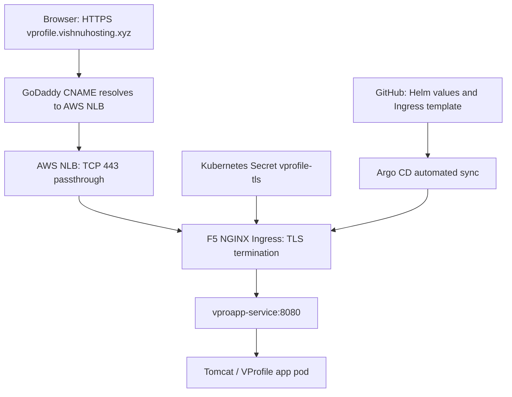
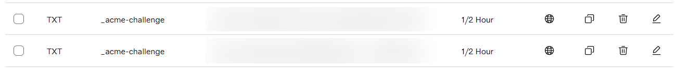
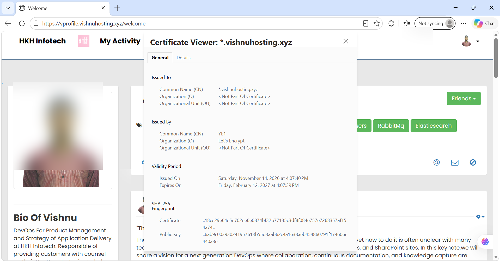

# Phase 7 - Let's Encrypt Wildcard TLS and HTTPS on EKS

> **Project:** VProfile EKS GitOps | **AWS region:** `ap-southeast-2` | **Host:** `vprofile.vishnuhosting.xyz`  
> **Evidence:** `Untitled document (7).pdf` (4 pages, supplied on 14 November 2026), plus directly supplied Certbot and Git/Helm outputs and GoDaddy screenshots from the same conversation. Screenshots of the live certificate viewer are extracted from the PDF; DNS screenshots are from the earlier chat.  
> **Outcome:** HTTPS **HTTP 200**, trusted Let's Encrypt wildcard certificate (**TLS 1.3**), HTTP-to-HTTPS **301**, Argo CD **Synced / Healthy**, four Pods **Running** with zero restarts.

[Project overview](../../README.md) · [Phase 6: Argo CD](../argo-cd/README.md) · [Verified outputs](outputs/verified-phase7-terminal.txt) · [Read-only verification script](outputs/verify-https-readonly.sh)

## 1. What we implemented

The site used to load on HTTP. We obtained a Let's Encrypt **wildcard certificate** and a certificate covering the base `vishnuhosting.xyz` domain through **Certbot manual DNS-01 challenges**. We put `fullchain.pem` and `privkey.pem` into a Kubernetes TLS Secret named `vprofile-tls` in namespace `default`, using a locally generated **declarative Secret YAML** (not committed to Git). Then we set the Helm value `ingress.tlsSecretName`, preserved the template's conditional `tls:` block, and added the F5 NGINX `nginx.org/ssl-redirect: "true"` annotation. Git pushed the Ingress desired state; Argo CD reconciled it. The NLB passes TCP 443 to the NGINX controller, which terminates TLS and forwards HTTP to Tomcat on port 8080.



**Scope:** HTTPS is encrypted from the browser to NGINX; NGINX-to-Tomcat traffic is HTTP within Kubernetes. This setup does **not** imply end-to-end encryption to the application pod. No AWS Certificate Manager certificate or second NLB is required for this architecture.

## 2. Requirements and recorded environment

| Component | Evidence / implementation |
| --- | --- |
| Domain registrar / DNS | GoDaddy; `vprofile` CNAME points to the Sydney NLB hostname |
| Kubernetes | Amazon EKS in `ap-southeast-2`, application namespace `default` |
| NGINX | F5 NGINX Ingress Controller, `ingressClassName: nginx` |
| TLS Secret | `vprofile-tls`, type `kubernetes.io/tls`, two data keys |
| Certbot output | `fullchain.pem`, `privkey.pem` under `/etc/letsencrypt/live/vishnuhosting.xyz/` |
| Certificate | `CN=*.vishnuhosting.xyz`, issued by Let's Encrypt `YE1`, expires **2027-02-12** |
| Application service | `vproapp-service:8080` |
| GitOps | `argocd/Application vprofile`, `Synced / Healthy` |

## 3. Certificate request and DNS-01 verification

### 3.1 Install the client on Ubuntu

```bash
sudo apt update
sudo apt install -y certbot dnsutils
certbot --version
```

The user ran a successful **manual DNS** issuance with this same certificate name and requested names:

```bash
sudo certbot certonly \
  --manual \
  --preferred-challenges dns \
  --cert-name vishnuhosting.xyz \
  --email YOUR_OWN_MONITORED_EMAIL@example.com \
  --agree-tos \
  --server https://acme-v02.api.letsencrypt.org/directory \
  -d '*.vishnuhosting.xyz' \
  -d 'vishnuhosting.xyz'
```

`*.vishnuhosting.xyz` covers **one-level subdomains** such as `vprofile.vishnuhosting.xyz`; a wildcard alone does not cover the root domain, so the extra `-d 'vishnuhosting.xyz'` is intentional. Use an email address you control for expiry notices.

### 3.2 Add TXT records through GoDaddy

Certbot prompted for TXT records named `_acme-challenge.vishnuhosting.xyz`. Both the wildcard and apex-domain challenges use the **same record name** but **distinct values**. Add multiple TXT records instead of replacing the first pending challenge. The initial attempt in the conversation failed because Let's Encrypt saw an incorrect/old value while verifying one challenge. The later attempt succeeded after the new values propagated.

1. Leave Certbot at the `Press Enter to Continue` prompt.
2. In GoDaddy DNS, add/edit **TXT** `Name: _acme-challenge` and `Value: <CURRENT CERTBOT TOKEN>`.
3. For the second challenge, keep the first new value and add the second at the same name.
4. Verify using both authoritative and public DNS resolvers **before** pressing Enter for the second prompt:

```bash
dig @ns23.domaincontrol.com TXT _acme-challenge.vishnuhosting.xyz +short
dig @ns24.domaincontrol.com TXT _acme-challenge.vishnuhosting.xyz +short
dig @8.8.8.8 TXT _acme-challenge.vishnuhosting.xyz +short
dig @1.1.1.1 TXT _acme-challenge.vishnuhosting.xyz +short
```

**TTL is a cache lifetime, not a fixed propagation delay.** The DNS screenshots showed TTL selections including 30 minutes; it does not mean a new record must take exactly 30 minutes to appear. When retrying Certbot, use **new token values** from the new request, not values from a failed request.



### 3.3 Confirm issuance

The supplied console showed:

```text
Successfully received certificate.
Certificate is saved at: /etc/letsencrypt/live/vishnuhosting.xyz/fullchain.pem
Key is saved at:         /etc/letsencrypt/live/vishnuhosting.xyz/privkey.pem
This certificate expires on 2027-02-12.
```

Read-only local checks (do not print the private key):

```bash
sudo certbot certificates
sudo openssl x509 -in /etc/letsencrypt/live/vishnuhosting.xyz/fullchain.pem \
  -noout -dates -issuer -ext subjectAltName
```

**Manual DNS-01 certificates do not auto-renew** without an authentication hook or a DNS automation integration. Certificate paths are not `/etc/ssl/certs/` unless you separately copy files; copying is unnecessary for Kubernetes.

## 4. Create the TLS Secret using a declarative YAML file

Kubernetes needs `data.tls.crt` and `data.tls.key` (base64 encoded) for type `kubernetes.io/tls`. The following generates an actual manifest **locally** using kubectl's client-side dry-run: it does not create anything until the subsequent `apply`. `kubectl` must have access to the correct EKS kubeconfig; the example uses the current admin instance's `ubuntu` kubeconfig while reading root-protected PEM files.

```bash
sudo mkdir -p /root/vprofile-secrets
sudo bash -c '
  umask 077
  kubectl --kubeconfig=/home/ubuntu/.kube/config create secret tls vprofile-tls \
    --cert=/etc/letsencrypt/live/vishnuhosting.xyz/fullchain.pem \
    --key=/etc/letsencrypt/live/vishnuhosting.xyz/privkey.pem \
    --namespace default \
    --dry-run=client -o yaml > /root/vprofile-secrets/vprofile-tls.yaml
'

sudo kubectl --kubeconfig=/home/ubuntu/.kube/config apply \
  -f /root/vprofile-secrets/vprofile-tls.yaml
```

This is a reproducible procedure for this environment, **not a claim that these exact commands were recorded in PDF 7**. The PDF shows the successfully created Secret:

```text
$ kubectl get secret vprofile-tls -n default
NAME           TYPE                DATA   AGE
vprofile-tls   kubernetes.io/tls   2      164m
```

**Secret security:** the YAML file is a sensitive private-key container even though its fields are base64. Never add it to GitHub, CI artifacts, screenshots, or logs. Keep it root-readable only and outside the cloned project. The package contains an intentionally **nonfunctional placeholder** at [`reference/tls-secret-template-DO-NOT-APPLY.yaml`](reference/tls-secret-template-DO-NOT-APPLY.yaml). A production GitOps pattern would automate certificate issuance with cert-manager and a DNS API integration, or use a dedicated encrypted secret-management workflow.

## 5. Helm chart: reference the existing Secret

The active manifests are in the application's real chart (`helm/vprofile-chart/`), not duplicated in this documentation archive. The relevant observed values were:

```yaml
ingress:
  enabled: true
  className: nginx
  host: vprofile.vishnuhosting.xyz
  tlsSecretName: vprofile-tls
```

The existing `helm/vprofile-chart/templates/appingress.yaml` **already had** a conditional `tls:` template. This was established when the user ran `helm template` and it rendered the Secret correctly. The only later Ingress template change needed was the redirect annotation under `metadata`:

```yaml
metadata:
  name: vpro-ingress
  annotations:
    nginx.org/ssl-redirect: "true"
spec:
  ingressClassName: {{ .Values.ingress.className | quote }}
  {{- if .Values.ingress.tlsSecretName }}
  tls:
    - hosts:
        - {{ .Values.ingress.host | quote }}
      secretName: {{ .Values.ingress.tlsSecretName | quote }}
  {{- end }}
```

Check the actual chart:

```bash
cd ~/vprofile-eks-gitops
helm lint helm/vprofile-chart
helm template vprofile helm/vprofile-chart --show-only templates/appingress.yaml
```

The Helm output in the chat passed lint with **zero failed charts**, and rendered both `spec.tls` and `nginx.org/ssl-redirect: "true"` while retaining `/ -> vproapp-service:8080`.

### Git rebase and Argo CD Auto Sync

A push initially failed because GitHub Actions had added newer commits on `origin/main`, and a `.git/FETCH_HEAD` permission error was fixed by changing `.git` ownership back to `ubuntu`. The user then successfully ran `git fetch origin`, `git rebase origin/main`, and pushed rebased commit `9476ea9` after origin revision `c2e57d1`. The subsequent template annotation change was then pushed separately; its new commit hash is **not supplied**. **Do not force-push or discard the GitHub Actions image-tag commit.**

```
GitHub repository (main)
   -> Argo CD watches helm/vprofile-chart
   -> renders vpro-ingress with tls.secretName=vprofile-tls
   -> applies Ingress in namespace default
   -> NGINX reads TLS Secret and serves HTTPS
```

After the update, actual verification in the PDF returned:

```text
$ kubectl get applications -n argocd
NAME       SYNC STATUS   HEALTH STATUS
vprofile   Synced        Healthy
```

## 6. What happens to the request

- A browser resolves the GoDaddy `vprofile` CNAME to the public AWS Network Load Balancer.
- The AWS NLB listener forwards TCP port **443** to F5 NGINX; NGINX, **not the NLB**, terminates TLS using `vprofile-tls`.
- NGINX forwards the decrypted request to `vproapp-service` on port **8080**, which routes to the application Pod.
- For HTTP on port **80**, `nginx.org/ssl-redirect: "true"` redirects to HTTPS.

Evidence from the PDF's `kubectl describe ingress`:

```text
TLS:
  vprofile-tls terminates vprofile.vishnuhosting.xyz
Rules:
  vprofile.vishnuhosting.xyz
    /   vproapp-service:8080 (192.168.8.49:8080)
Annotations:
  nginx.org/ssl-redirect: true
```

## 7. Verified outcomes: live website, certificate and workloads

| Test | Recorded result | Assessment |
| --- | --- | --- |
| `kubectl get secret` | `kubernetes.io/tls`, 2 keys | Pass |
| `kubectl describe ingress` | `vprofile-tls` TLS host, F5 redirect annotation | Pass |
| `kubectl get applications` | `vprofile Synced Healthy` | Pass |
| `kubectl get pods` | 4/4 pods Ready/Running, zero restarts | Pass |
| `curl -Iv https://...` | TLS 1.3; Let's Encrypt `YE1`, hostname match, `SSL certificate verify ok.` | Pass |
| `curl -I https://...` | HTTP `200` | Pass |
| `curl -I http://...` | HTTP `301`, `Location: https://vprofile.vishnuhosting.xyz:443/` | Pass |
| Browser certificate viewer | Let's Encrypt certificate for `*.vishnuhosting.xyz`, expiry 12 Feb 2027 | Pass |



Specific excerpt, with cookie value redacted:

```text
$ curl -Iv https://vprofile.vishnuhosting.xyz
* SSL connection using TLSv1.3 / TLS_AES_256_GCM_SHA384 / X25519 / id-ecPublicKey
* subject: CN=*.vishnuhosting.xyz
* subjectAltName: host "vprofile.vishnuhosting.xyz" matched cert's "*.vishnuhosting.xyz"
* issuer: C=US; O=Let's Encrypt; CN=YE1
* SSL certificate verify ok.
< HTTP/1.1 200

$ curl -I http://vprofile.vishnuhosting.xyz
HTTP/1.1 301 Moved Permanently
Location: https://vprofile.vishnuhosting.xyz:443/
```

The explicit `:443` in the redirect URL is nonstandard aesthetically but valid: `443` is the default HTTPS port. The PDF's response sets `JSESSIONID` with `HttpOnly` but without an observed `Secure` cookie attribute. That is an outstanding **session-cookie hardening task**, not a certificate-validation failure.

## 8. Certificate renewal: operations and limitations

- Certificate validity recorded: **14 November 2026 - 12 February 2027**. Schedule renewal well before expiry, for example January 2027.
- Certbot's own success output states the `--manual` certificate **will not renew automatically**. Running an ordinary unattended renewal is insufficient unless an authentication hook or DNS API automation is added.
- Rerun the manual DNS challenge using **fresh TXT values**, verify propagation, and complete issuance.
- Regenerate the **private YAML** using the new `fullchain.pem` and `privkey.pem`, then **apply the updated YAML to the same Secret** in namespace `default` with a valid kubeconfig. NGINX is expected to pick up changes to the referenced Secret; verify the presented certificate using `curl -Iv` and the browser. If it doesn't, inspect NGINX controller logs/events rather than restarting application Pods by default.
- Reinspect the TLS Secret metadata and certificate expiry. Do not expose private key or certificate data unnecessarily.

For continuous production-grade renewal, consider **cert-manager with a supported GoDaddy DNS-01 integration** (or other DNS provider with automated API support) plus documented credential security. This project deliberately demonstrates manual issuance for interview evidence.

## 9. Security and cost considerations

- **No plaintext private keys in Git.** Base64 in Kubernetes Secret YAML is reversible; a bare manifest does not encrypt sensitive bytes.
- **Secure sessions.** Configure Tomcat to mark `JSESSIONID` as `Secure`, and evaluate SameSite, CSRF controls and reverse-proxy awareness; verify `Set-Cookie` headers after the change.
- **Traffic boundary.** TLS ends at NGINX, then internal backend traffic is HTTP. For highly sensitive deployments, consider internal TLS as a separate enhancement.
- **Public exposure.** Limit SSH access to the administration EC2, protect IAM privileges, and do not expose Argo CD directly without authentication and network controls.
- **Costs.** EKS control plane, NLB, EC2 worker and EBS incur charges even when traffic is low; delete lab resources deliberately after the interview demo.

## 10. Troubleshooting quick reference

| Symptom | Check |
| --- | --- |
| DNS TXT challenge rejected | Fresh tokens; **both values simultaneously**; authoritative/public DNS output; TTL cache |
| `kubectl apply` permission error | Correct user, kubeconfig, AWS role, root-only YAML file permissions |
| Argo CD Healthy but no TLS | `helm template` has `spec.tls`? Is the exact Git revision synchronized? |
| NGINX default certificate | Same namespace as Ingress? Valid `tls.crt`/`tls.key`? Host matches wildcard? Controller logs |
| HTTPS timeout | NLB TCP 443, target group health, node/target ports and security groups |
| HTTP still returns 200 | Redirect annotation present on **live** Ingress? NGINX controller reconciled? |
| Certificate expired after renewal | Renewed PEM files then **re-apply** TLS Secret and verify live certificate |

## 11. What is and isn't proven

**Proven:** successful public certificate trust and hostname match; HTTPS 200; HTTP 301 redirect; live Ingress TLS Secret reference; successful Argo CD sync and four running pods; browser displays a certificate issued by Let's Encrypt.

**Not established by the supplied material:** every application business feature, an automatic certificate renewal job, a `Secure` session-cookie flag, mTLS/internal encryption, or an independent active availability monitoring policy.

## 12. Evidence map and documentation integrity

- [`outputs/verified-phase7-terminal.txt`](outputs/verified-phase7-terminal.txt) - actual outputs transcribed from pages 1-3; JSESSIONID values redacted.
- [`screenshots/browser-le-certificate-redacted.png`](screenshots/browser-le-certificate-redacted.png) - actual certificate-viewer screenshot extracted from page 4; profile photos blurred for public GitHub.
- [`screenshots/godaddy-txt-records-redacted.png`](screenshots/godaddy-txt-records-redacted.png) - screenshot from prior chat, not PDF 7; challenge TXT values blurred.
- [`outputs/verify-https-readonly.sh`](outputs/verify-https-readonly.sh) - read-only verification steps for a new engineer.
- [`reference/tls-secret-template-DO-NOT-APPLY.yaml`](reference/tls-secret-template-DO-NOT-APPLY.yaml) - sanitized illustrative structure only, **not deployable**.

The project retains its real live files in `helm/vprofile-chart/` and `argocd/`; this chapter does not overwrite or clone them. The original evidence PDF can be kept in a private project folder, but it contains a session identifier and identifiable profile imagery, so it should not be uploaded to a public repo without sanitization.
