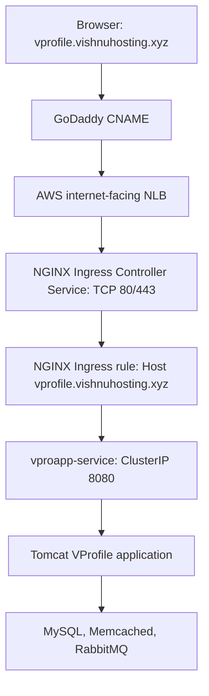
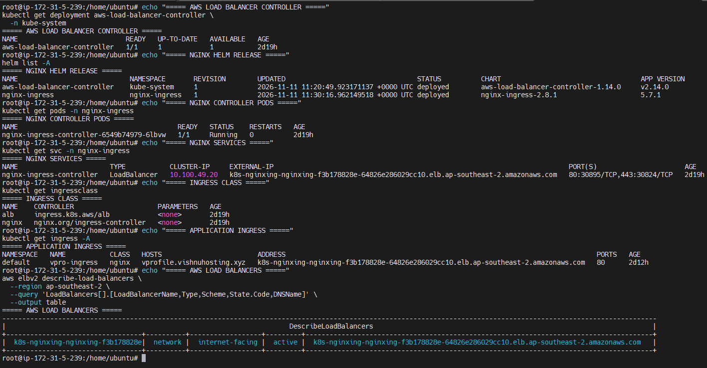
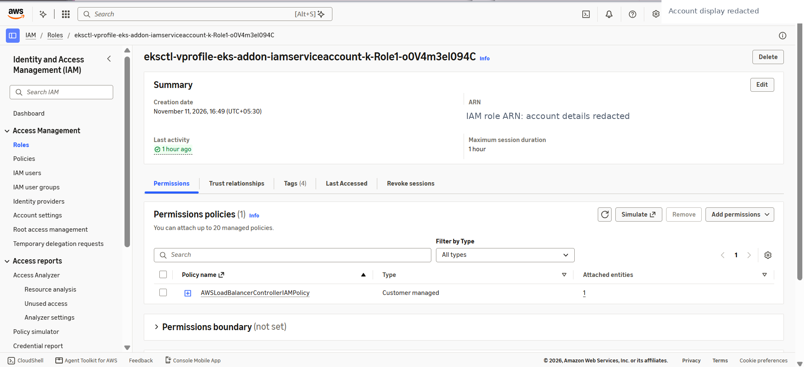
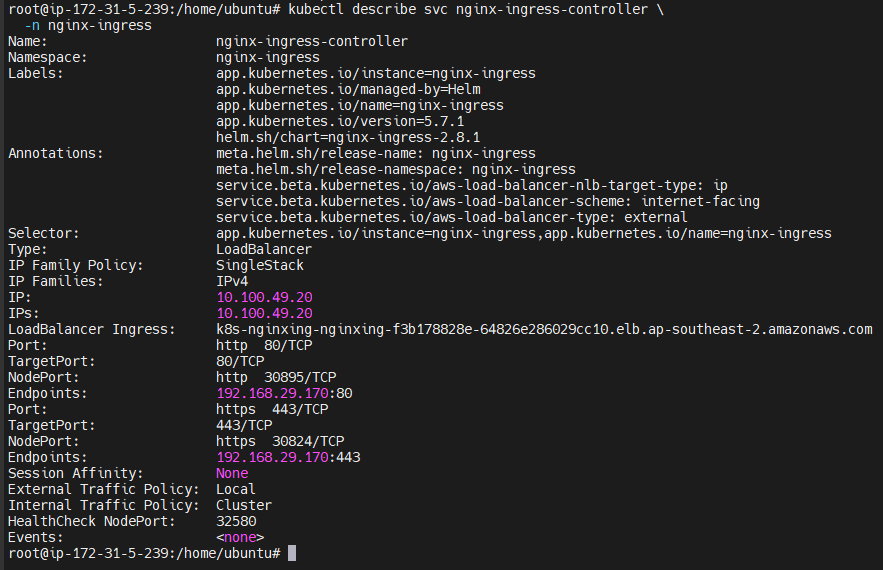
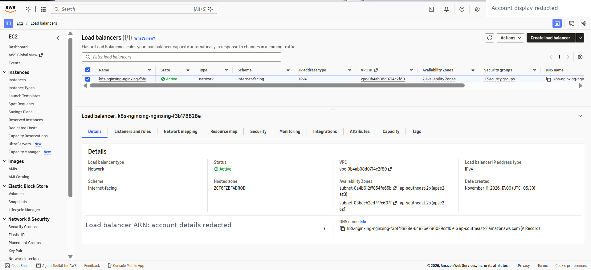
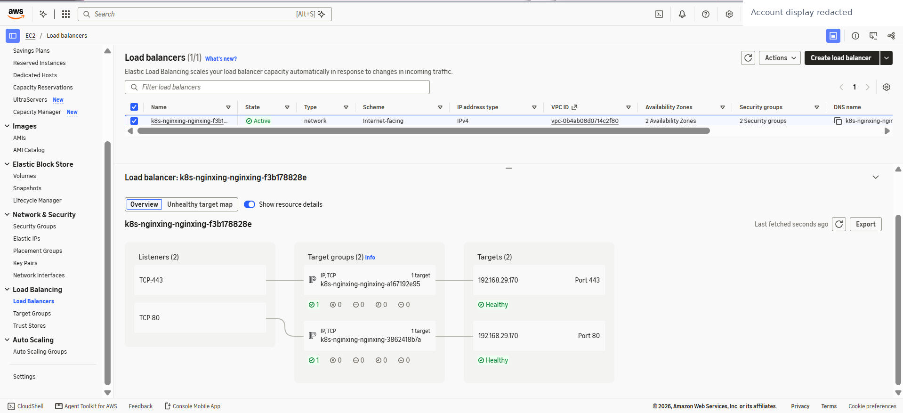
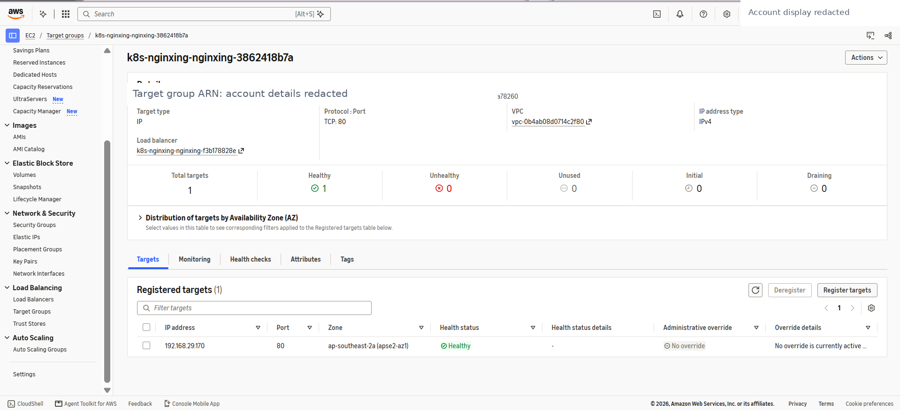
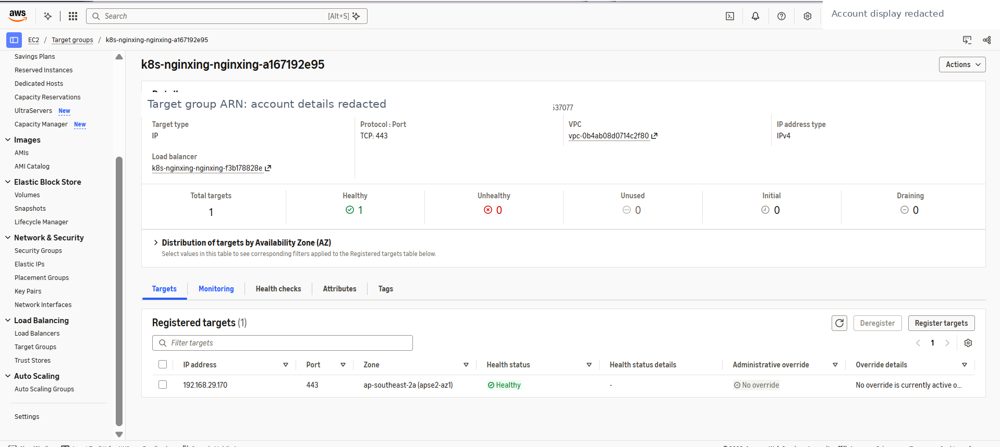

# Phase 4 - AWS Load Balancer Controller and NGINX Ingress

> **Project:** VProfile EKS GitOps | **Region:** `ap-southeast-2` (Sydney) | **Cluster:** `vprofile-eks`  
> **Documentation basis:** User-supplied nine-page Phase 4 PDF, with real terminal and AWS Console screenshots. The installation commands are reconstructed from the recorded deployment history and distinguish observed evidence from setup instructions.

[Back to project documentation](../../README.md) | [EKS chapter](../eks-cluster/README.md) | [Persistent storage chapter](../persistent-storage/README.md)

## 1. Goal and technical architecture

The aim is to expose the Java VProfile application publicly through a Kubernetes `Ingress` without giving the application its own AWS load balancer. Traffic enters an AWS **Network Load Balancer (NLB)**, reaches the **F5 NGINX Ingress Controller**, follows an HTTP hostname rule, and is sent to the Kubernetes `vproapp-service` on port 8080.



**Important distinction:** the **AWS Load Balancer Controller** is a Kubernetes/AWS infrastructure controller that can reconcile suitable Kubernetes `Service` and `Ingress` objects into AWS load balancer resources. The **NGINX Ingress Controller** processes Layer-7 HTTP routing rules inside Kubernetes. They are different deployments. This evidence proves that an NLB backs the NGINX Service; it does not by itself identify which controller initially provisioned that NLB. Verify ownership using Service annotations/events and AWS resource tags.

## 2. What was actually observed

| Layer | Observed result | Source |
|---|---|---|
| AWS Load Balancer Controller | `1/1` available in `kube-system` | [Terminal screenshot](screenshots/kubectl-lbc-nginx-nlb-verification.png) |
| Helm releases | `aws-load-balancer-controller` chart `1.14.0`, app `v2.14.0`; `nginx-ingress` chart `2.8.1`, app `5.7.1` | [Terminal screenshot](screenshots/kubectl-lbc-nginx-nlb-verification.png) |
| NGINX Controller | Pod `1/1 Running` in `nginx-ingress` | [Terminal screenshot](screenshots/kubectl-lbc-nginx-nlb-verification.png) |
| Service | `nginx-ingress-controller`, type `LoadBalancer`, ports `80` and `443` | [Service details](screenshots/kubectl-nginx-service-annotations.png) |
| Ingress classes | `alb` (`ingress.k8s.aws/alb`) and `nginx` (`nginx.org/ingress-controller`) | [Terminal screenshot](screenshots/kubectl-lbc-nginx-nlb-verification.png) |
| Application Ingress | `vpro-ingress`, namespace `default`, host `vprofile.vishnuhosting.xyz` | [Terminal screenshot](screenshots/kubectl-lbc-nginx-nlb-verification.png) |
| AWS load balancer | Type **Network**, scheme **internet-facing**, state **active**, IPv4, 2 AZs | [AWS console](screenshots/aws-network-load-balancer-details.png) |
| Target groups | IP type, one **Healthy** target for TCP 80 and one for TCP 443 | [AWS target map](screenshots/aws-nlb-listeners-target-map.png) |
| IAM policy | Controller role has `AWSLoadBalancerControllerIAMPolicy` | [IAM role evidence](screenshots/aws-lbc-iam-role-permissions.png) |



## 3. Prerequisites

1. `vprofile-eks` exists, EKS worker is Ready, and `kubectl` can reach it.
2. Run commands from the Kubernetes admin EC2 (Ubuntu). Confirm AWS caller and region using `aws sts get-caller-identity` and `aws configure get region`.
3. AWS CLI, `kubectl`, `eksctl`, and Helm are installed. IAM identity has permissions to create the necessary IAM policies and service accounts.
4. Worker subnets and security groups permit the intended NLB traffic. For internet traffic, DNS must later point at the NLB hostname.
5. One-worker lab deployment: consider memory before adding more workloads.

```bash
aws sts get-caller-identity
kubectl get nodes -o wide
kubectl get pods -n kube-system
helm version --short
```

## 4. AWS Load Balancer Controller IAM setup

The original deployment used IAM Roles for Service Accounts (IRSA). The controller IAM role was created by `eksctl create iamserviceaccount`, and the attached policy is visible in the AWS console.

**Original implementation command sequence (recorded in conversation):**

```bash
# Already performed in this project; do not rerun blindly if installed.
eksctl utils associate-iam-oidc-provider \
  --cluster vprofile-eks \
  --region ap-southeast-2 \
  --approve

# Release-specific IAM policy was downloaded at implementation time:
curl -fsSL \
  https://raw.githubusercontent.com/kubernetes-sigs/aws-load-balancer-controller/v2.14.1/docs/install/iam_policy.json \
  -o /tmp/aws-lbc-policy.json

aws iam create-policy \
  --policy-name AWSLoadBalancerControllerIAMPolicy \
  --policy-document file:///tmp/aws-lbc-policy.json

ACCOUNT_ID=$(aws sts get-caller-identity --query Account --output text)

eksctl create iamserviceaccount \
  --cluster vprofile-eks \
  --region ap-southeast-2 \
  --namespace kube-system \
  --name aws-load-balancer-controller \
  --attach-policy-arn "arn:aws:iam::${ACCOUNT_ID}:policy/AWSLoadBalancerControllerIAMPolicy" \
  --approve
```

**Why:** AWS Load Balancer Controller needs AWS API permissions to manage NLB/ALB-related resources. IRSA associates those permissions with a Kubernetes ServiceAccount instead of putting AWS keys into the pod. For new deployments, check the IAM policy and version requirements in the official controller documentation; the included JSON is a provided evidence snapshot, not a future-proof installation policy.

**Verify the actual role and permissions:**

```bash
kubectl get sa aws-load-balancer-controller -n kube-system \
  -o jsonpath='{.metadata.annotations.eks\.amazonaws\.com/role-arn}{"\n"}'

kubectl get deployment aws-load-balancer-controller -n kube-system
kubectl describe sa aws-load-balancer-controller -n kube-system
```



The screenshot proves that the policy is attached to the shown IAM role. The ServiceAccount command above is the definitive check to link that role to the running Kubernetes controller. See also the [supplied policy reference](reference/README.md).

## 5. Install the AWS Load Balancer Controller with Helm

**Recorded installation command:**

```bash
helm repo add eks https://aws.github.io/eks-charts
helm repo update eks

helm upgrade --install aws-load-balancer-controller \
  eks/aws-load-balancer-controller \
  -n kube-system \
  --version 1.14.0 \
  --set clusterName=vprofile-eks \
  --set serviceAccount.create=false \
  --set serviceAccount.name=aws-load-balancer-controller \
  --set replicaCount=1

kubectl rollout status deployment/aws-load-balancer-controller -n kube-system
```

- `--version` pins the Helm chart to the version deployed in this lab.
- `serviceAccount.create=false` reuses the IRSA-connected ServiceAccount created by `eksctl`.
- `replicaCount=1` conserves resources on the single EKS worker.
- `kubectl rollout status` ensures that the controller Deployment becomes available.

## 6. Install F5 NGINX Ingress Controller with Helm

This project uses **F5 NGINX Ingress Controller** (`nginx.org/ingress-controller`), not the separate community `ingress-nginx` controller. These projects have different Helm charts and annotation conventions.

**Recorded installation command:**

```bash
cd ~/vprofile-eks-gitops

helm template nginx-ingress \
  oci://ghcr.io/nginx/charts/nginx-ingress \
  --version 2.8.1 \
  --namespace nginx-ingress \
  -f eks/nginx-values.yaml \
  > /tmp/nginx-rendered.yaml

helm upgrade --install nginx-ingress \
  oci://ghcr.io/nginx/charts/nginx-ingress \
  --version 2.8.1 \
  --namespace nginx-ingress \
  --create-namespace \
  -f eks/nginx-values.yaml
```

**Purpose:** The `helm template` command previews the Kubernetes manifests; `helm upgrade --install` deploys the controller and creates the public LoadBalancer Service. Keep your real `eks/nginx-values.yaml` as the authoritative file: its complete original content is not in the evidence PDF. A [Service-annotation reference](reference/observed-nginx-service-annotations.yaml) records only values verified from the live Service.

Check the Helm release, pods, Service and IngressClass:

```bash
helm list -A
kubectl get deployment -n nginx-ingress
kubectl get pods -n nginx-ingress
kubectl get svc -n nginx-ingress
kubectl get ingressclass
```

The recorded Helm result had two deployed releases. The controller Pod was `1/1 Running`; its external Service hostname was:

```text
k8s-nginxing-nginxing-f3b178828e-64826e286029cc10.elb.ap-southeast-2.amazonaws.com
```

## 7. Why AWS provisioned an NLB and how its traffic flows

The NGINX controller Service was `type: LoadBalancer` and had these **observed annotations**:

```yaml
service.beta.kubernetes.io/aws-load-balancer-nlb-target-type: ip
service.beta.kubernetes.io/aws-load-balancer-scheme: internet-facing
service.beta.kubernetes.io/aws-load-balancer-type: external
```

- **`external`** requests the external AWS Load Balancer Controller handling pattern for the Service (in environments configured for that controller).
- **`internet-facing`** makes the load balancer reachable from internet-facing subnets.
- **`ip`** directs traffic to registered IP targets rather than EC2 instance NodePorts.



The AWS Console independently confirmed an **active internet-facing Network Load Balancer** distributed across two AZs:



The resource map showed **two TCP listeners** (80 and 443), each forwarding to an IP target group. One target was healthy in each group:



The separate target group screens confirm TCP/80 and TCP/443, target type IP and `1 Healthy / 0 Unhealthy`:





**Note on TLS:** Having an NLB TCP listener on port 443 does not by itself prove that a valid TLS certificate has been configured at NGINX. In this project HTTP traffic was tested separately. Do not call the site HTTPS-secured until a certificate, TLS Secret and application-level TLS verification are complete.

## 8. Configure host-based application routing

The Helm chart's `vpro-ingress` resource uses `ingressClassName: nginx` and a hostname rule for `vprofile.vishnuhosting.xyz`, forwarding to `vproapp-service` port 8080. The deployment source remains `helm/vprofile-chart/templates/appingress.yaml` (link below assumes this repository structure).

```bash
kubectl get ingress -A
kubectl describe ingress vpro-ingress -n default
kubectl get svc vproapp-service -n default
kubectl get endpointslices -n default -l kubernetes.io/service-name=vproapp-service
```

**Conceptual manifest excerpt (not a claim of exact source file contents):**

```yaml
apiVersion: networking.k8s.io/v1
kind: Ingress
metadata:
  name: vpro-ingress
spec:
  ingressClassName: nginx
  rules:
  - host: vprofile.vishnuhosting.xyz
    http:
      paths:
      - path: /
        pathType: Prefix
        backend:
          service:
            name: vproapp-service
            port:
              number: 8080
```

[View existing Helm Ingress template](../../helm/vprofile-chart/templates/appingress.yaml)

## 9. Verify NLB and NGINX independently

```bash
aws elbv2 describe-load-balancers \
  --region ap-southeast-2 \
  --query 'LoadBalancers[].[LoadBalancerName,Type,Scheme,State.Code,DNSName]' \
  --output table

NLB_DNS=$(kubectl get svc nginx-ingress-controller -n nginx-ingress \
  -o jsonpath='{.status.loadBalancer.ingress[0].hostname}')

curl -i --connect-timeout 10 \
  -H 'Host: vprofile.vishnuhosting.xyz' \
  "http://${NLB_DNS}/"
```

**Interpretation:** Before the app's Ingress rule was created, the test returned an NGINX `404 Not Found`, confirming the request reached the NGINX controller but had no matching route. After the Helm application was synchronized and pods were ready, the same NLB-host test returned HTTP `200` and the VProfile login HTML (as observed elsewhere in this project). The attached Phase 4 PDF specifically confirms the installed controllers, Ingress rule and AWS target health; it does not contain the later HTTP 200 browser screenshot.

## 10. Troubleshooting cheat sheet

| Problem | Likely layer | Useful checks |
|---|---|---|
| NLB not provisioned | Service annotations / controller permissions / subnets | `kubectl describe svc ...`, controller logs, IAM trust, subnet tags |
| Targets unhealthy | Target registration, pod readiness, security groups | AWS Target Group health, `kubectl get pods`, `kubectl get svc -o yaml` |
| HTTP 404 (NGINX) | Ingress hostname/path not matched | `kubectl get ingress`, `curl -H 'Host: ...'` |
| HTTP 502/504 | Backend pod/Service or slow startup | `kubectl get endpointslices`, app logs, NGINX logs |
| DNS not resolving | GoDaddy CNAME or resolver cache | `dig +short NS`, `dig @ns23.domaincontrol.com ... CNAME` |
| HTTPS warning | TLS not configured/trusted | Inspect TLS Secret, certificate chain, NGINX TLS configuration |
| `alb` IngressClass exists | Normal; class registry != running ALB | Check `aws elbv2 describe-load-balancers` |

Use **non-destructive** diagnostics first. Do not delete the NGINX release or the AWS load balancer merely to clear a route error.

## 11. Security, maintenance and cost notes

- Do not publish secrets, AWS tokens, private keys or raw login passwords in documentation.
- AWS account identifiers in screenshots have been redacted where practical; confirm every screenshot before public publication.
- IAM controller permissions should be bound to the dedicated ServiceAccount, not hard-coded AWS credentials.
- An internet-facing NLB incurs cost even when idle. Remove it intentionally when dismantling the lab and verify the AWS resource disappears.
- The project is a single-node demo. Plan more worker capacity for high availability and maintainable upgrades.
- Treat `latest` for production deployments as non-pinned; prefer Git SHA or immutable image digests.

## 12. Screenshot and evidence index

All figures are derived from the nine-page user-uploaded Phase 4 PDF. The IAM policy JSON is included as submitted, with no claim that it is the latest recommended policy.

| File | What it demonstrates |
|---|---|
| [`screenshots/kubectl-lbc-nginx-nlb-verification.png`](screenshots/kubectl-lbc-nginx-nlb-verification.png) | Live `kubectl`, `helm list`, AWS CLI results |
| [`screenshots/aws-network-load-balancer-details.png`](screenshots/aws-network-load-balancer-details.png) | Active internet-facing NLB and two AZs |
| [`screenshots/aws-nlb-listeners-target-map.png`](screenshots/aws-nlb-listeners-target-map.png) | TCP listeners and healthy target map |
| [`screenshots/aws-target-group-http-80.png`](screenshots/aws-target-group-http-80.png) | One healthy IP target for port 80 |
| [`screenshots/aws-target-group-tcp-443.png`](screenshots/aws-target-group-tcp-443.png) | One healthy IP target for port 443 |
| [`screenshots/aws-lbc-iam-role-permissions.png`](screenshots/aws-lbc-iam-role-permissions.png) | Role and attached `AWSLoadBalancerControllerIAMPolicy` |
| [`screenshots/kubectl-nginx-service-annotations.png`](screenshots/kubectl-nginx-service-annotations.png) | Service annotations, ClusterIP, NLB hostname, ports/endpoints |
| [`outputs/verified-terminal-output.txt`](outputs/verified-terminal-output.txt) | Concise transcription of terminal outputs |

**Related chapters:** [Phase 1: Administration EC2](../ec2-administration/README.md) | [Phase 2: EKS](../eks-cluster/README.md) | [Phase 3: Storage](../persistent-storage/README.md)
