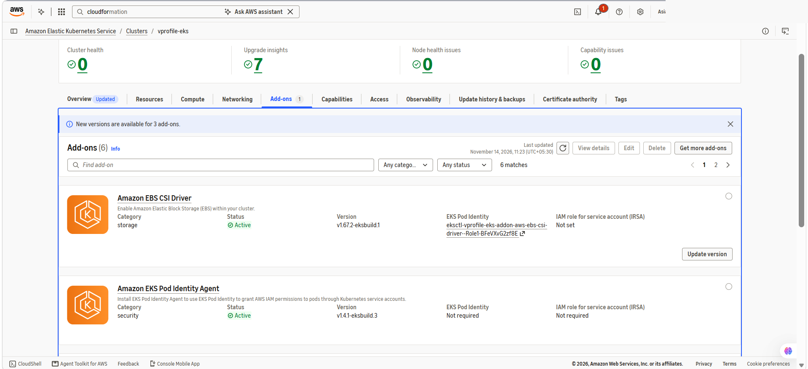
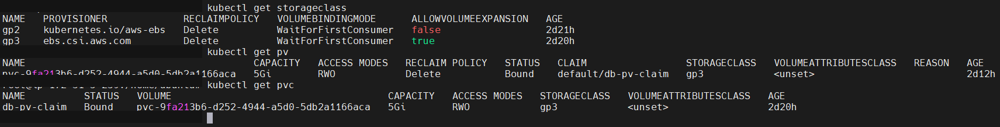
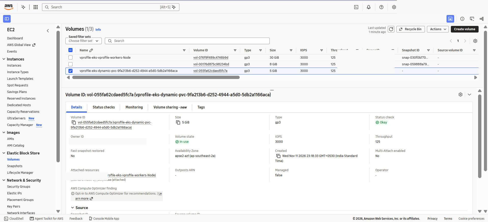

# Phase 03 - Amazon EBS CSI Driver, Pod Identity and MySQL persistent storage

> **Evidence status:** Verified from the uploaded three-screenshot PDF captured on 14 November 2026. The AWS console shows the EBS CSI Driver and Pod Identity Agent as **Active**, the EC2 volume as **5 GiB gp3 / In-use**, and the actual `kubectl get pv`, `get pvc`, and `get storageclass` output shows the PVC **Bound**. Command installation excerpts below are supported by the earlier project terminal transcript, not by this new screenshot PDF.  
> **Region:** `ap-southeast-2` (Sydney). **Namespace:** `default`.  
> **Security:** Image copies in this documentation folder are redacted. The source screenshots are not included unredacted.

[Project overview](../../README.md) | [Phase 02 - EKS cluster](../eks-cluster/README.md) | [Storage verification transcript](outputs/storage-verification.txt) | [Existing StorageClass manifest](../../bootstrap/storageclass.yaml) | [Existing PVC manifest](../../bootstrap/db-pvc.yaml)

## Objective

Enable the Amazon EBS CSI Driver to dynamically provision EBS storage for a stateful MySQL pod on the EKS worker. Associate the driver with AWS IAM permissions using **EKS Pod Identity**, create a `gp3` StorageClass and a MySQL PersistentVolumeClaim (PVC), and prove the relationship from the Kubernetes PVC to the AWS EBS volume. These steps should be performed **after** the EKS cluster and managed worker become Ready.

## Evidence-first overview

| Resource / setting | Value supported by the evidence |
| --- | --- |
| EKS cluster | `vprofile-eks` |
| AWS Region / volume AZ | `ap-southeast-2` / `ap-southeast-2a` |
| EBS CSI Driver | **Active**, screenshot lists `v1.67.2-eksbuild.1` |
| EKS Pod Identity Agent | **Active**, screenshot lists `v1.4.1-eksbuild.3` |
| StorageClass name | `gp3` |
| StorageClass provisioner | `ebs.csi.aws.com` |
| StorageClass reclaim policy | `Delete` |
| Volume binding mode | `WaitForFirstConsumer` |
| Volume expansion | `true` |
| PVC | `db-pv-claim` in `default` |
| PVC state | **Bound** |
| PV capacity / access | **5Gi**, `ReadWriteOnce` |
| EBS volume | **In-use**, `gp3`, 5 GiB, 3000 provisioned IOPS, 125 MiB/s provisioned throughput |
| Evidence date | 14 November 2026 (AWS console / terminal screenshots) |

### Storage data path

```text
VProfile MySQL Deployment (vprodb)
        |
        | volumeMount: /var/lib/mysql
        v
PersistentVolumeClaim (db-pv-claim, default namespace)
        |  storageClassName: gp3, requested 5Gi
        v
PersistentVolume (dynamically provisioned; bound)
        |  CSI driver: ebs.csi.aws.com
        v
AWS EBS gp3 volume (5 GiB, ap-southeast-2a, In-use)
        |  attached to the worker hosting MySQL
        v
MySQL data directory persists across pod replacement
```

**Important:** EBS is Availability Zone-specific and cannot freely attach to a node in another AZ. The volume is not a database backup. If the PVC/PV with a `Delete` reclaim policy is deleted, the provisioned EBS volume may be deleted too. Back up data before destroying anything.

## Step 1 - Check EKS and baseline add-ons

```bash
aws eks update-kubeconfig --name vprofile-eks --region ap-southeast-2
kubectl get nodes -o wide
aws eks list-addons --cluster-name vprofile-eks --region ap-southeast-2
```

**Why:** Confirms the correct cluster context and that at least one worker is Ready before installing the storage components. The four baseline add-ons in the creation transcript were CoreDNS, kube-proxy, VPC CNI and metrics-server. The CSI driver and Pod Identity Agent were installed later.

## Step 2 - Install the EKS Pod Identity Agent

This is the earlier project command, supplied in the terminal conversation:

```bash
eksctl create addon \
  --cluster vprofile-eks \
  --region ap-southeast-2 \
  --name eks-pod-identity-agent
```

**Why:** The Pod Identity Agent enables authorized pods and service accounts to receive temporary AWS role credentials. It does not give every pod unrestricted IAM permissions.

Verify:

```bash
aws eks describe-addon \
  --cluster-name vprofile-eks \
  --addon-name eks-pod-identity-agent \
  --region ap-southeast-2 \
  --query 'addon.{Status:status,Version:addonVersion,Issues:health.issues}'

kubectl get pods -n kube-system | grep pod-identity
```

**Observed later state:** The AWS EKS screenshot shows Pod Identity Agent **Active** at `v1.4.1-eksbuild.3`. This is later verification, not the original command output.

## Step 3 - Install the AWS EBS CSI Driver and associate IAM permissions

This is the command captured earlier in the deployment conversation:

```bash
eksctl create addon \
  --cluster vprofile-eks \
  --region ap-southeast-2 \
  --name aws-ebs-csi-driver \
  --auto-apply-pod-identity-associations
```

**Why:** The EBS CSI controller provisions and attaches EBS volumes in response to Kubernetes PVC requests. The `--auto-apply-pod-identity-associations` option creates/attaches recommended Pod Identity IAM role configuration for the add-on. Review the automatically assigned permissions in a non-lab environment.

Verify:

```bash
aws eks describe-addon \
  --cluster-name vprofile-eks \
  --addon-name aws-ebs-csi-driver \
  --region ap-southeast-2 \
  --query 'addon.{Status:status,Version:addonVersion,Issues:health.issues}'

kubectl get pods -n kube-system | grep ebs

aws eks list-pod-identity-associations \
  --cluster-name vprofile-eks \
  --region ap-southeast-2
```

**Observed state:** The uploaded AWS screenshot shows EBS CSI Driver **Active**, `v1.67.2-eksbuild.1`, with an **EKS Pod Identity role**. Its `IAM role for service account (IRSA)` field is *Not set*, which is expected for the Pod Identity approach.



*Figure 1 - Actual AWS EKS Add-ons console, captured 14 Nov 2026. Identifying account information is masked in the public copy. The displayed versions reflect the screenshot, not an installation pin.*

## Step 4 - Create the gp3 StorageClass

Reference to the project's existing [`bootstrap/storageclass.yaml`](../../bootstrap/storageclass.yaml). **Do not overwrite or reapply the manifest blindly if the StorageClass already exists.** The original manifest was not embedded in the newly uploaded PDF; this is a reproducible reference that matches the verified live StorageClass properties.

```yaml
apiVersion: storage.k8s.io/v1
kind: StorageClass
metadata:
  name: gp3
provisioner: ebs.csi.aws.com
parameters:
  type: gp3
  encrypted: "true"
reclaimPolicy: Delete
volumeBindingMode: WaitForFirstConsumer
allowVolumeExpansion: true
```

For new deployment only:

```bash
kubectl apply -f bootstrap/storageclass.yaml
```

Why each field matters:

| Setting | Purpose |
| --- | --- |
| `name: gp3` | StorageClass referenced by the MySQL PVC |
| `provisioner: ebs.csi.aws.com` | Use modern CSI EBS provisioning |
| `type: gp3` | Choose general-purpose SSD EBS storage |
| `encrypted: "true"` | Request encrypted EBS volumes through this class |
| `reclaimPolicy: Delete` | Dynamically provisioned backing volume is eligible for deletion when released |
| `WaitForFirstConsumer` | Defers provisioning to account for pod scheduling and AZ topology |
| `allowVolumeExpansion: true` | Allows supported PVC capacity increases |

**Observed output:** The uploaded terminal screenshot independently shows `gp3`, `ebs.csi.aws.com`, `Delete`, `WaitForFirstConsumer` and `true`. It also shows the older `gp2` class; do not confuse that legacy provisioner with this CSI class.

## Step 5 - Create the MySQL PersistentVolumeClaim

The example `bootstrap/db-pvc.yaml` below matches the observed claim size and StorageClass. This is **reference configuration**; its exact original file contents are not visible in the uploaded screenshot.

```yaml
apiVersion: v1
kind: PersistentVolumeClaim
metadata:
  name: db-pv-claim
  namespace: default
spec:
  accessModes:
    - ReadWriteOnce
  storageClassName: gp3
  resources:
    requests:
      storage: 5Gi
```

```bash
# On a new cluster, once the gp3 StorageClass exists:
kubectl apply -f bootstrap/db-pvc.yaml
kubectl get pvc db-pv-claim
```

**Why the claim may initially say `Pending`:** With `WaitForFirstConsumer`, the scheduler waits for a consuming pod such as `vprodb` to request the claim. It then picks appropriate topology and the CSI driver provisions the EBS volume. Do not delete the claim merely because it is pending before the MySQL deployment starts.

## Step 6 - Mount the claim inside the MySQL pod

The Helm chart's MySQL deployment, [`helm/vprofile-chart/templates/dbdeploy.yaml`](../../helm/vprofile-chart/templates/dbdeploy.yaml), should mount the claim under `/var/lib/mysql`. Confirm the actual committed YAML before a new deployment:

```yaml
volumeMounts:
  - name: vpro-db-data
    mountPath: /var/lib/mysql
volumes:
  - name: vpro-db-data
    persistentVolumeClaim:
      claimName: db-pv-claim
```

**Why:** `vprodb` uses the EBS-backed data directory so a pod replacement does not automatically erase MySQL data. Because the claim uses `ReadWriteOnce`, this lab keeps one MySQL replica rather than trying to mount the same EBS volume on unrelated nodes.

## Step 7 - Verify the actual Kubernetes PVC, PV and StorageClass

```bash
kubectl get storageclass
kubectl get pv
kubectl get pvc
kubectl describe pvc db-pv-claim
```

**Actual result shown in your screenshot (identifiers shortened for publication):**

```text
$ kubectl get storageclass
NAME  PROVISIONER              RECLAIMPOLICY  VOLUMEBINDINGMODE      ALLOWVOLUMEEXPANSION
gp2   kubernetes.io/aws-ebs   Delete         WaitForFirstConsumer   false
gp3   ebs.csi.aws.com         Delete         WaitForFirstConsumer   true

$ kubectl get pv
NAME                     CAPACITY  ACCESS MODES  RECLAIM POLICY  STATUS  CLAIM               STORAGECLASS
pvc-9fa213b6-[REDACTED]  5Gi       RWO           Delete          Bound   default/db-pv-claim  gp3

$ kubectl get pvc
NAME          STATUS  VOLUME                  CAPACITY  ACCESS MODES  STORAGECLASS
db-pv-claim   Bound   pvc-9fa213b6-[REDACTED] 5Gi       RWO           gp3
```



*Figure 2 - Original terminal result showing the `gp3` StorageClass, the `Bound` PV and the `Bound` PVC. Private prompt text is masked in this public version.*

## Step 8 - Match the Kubernetes PV to the real EBS volume

Get the EBS volume handle from the bound PersistentVolume:

```bash
PV_NAME=$(kubectl get pvc db-pv-claim -o jsonpath='{.spec.volumeName}')
echo "PV_NAME=$PV_NAME"

VOL_ID=$(kubectl get pv "$PV_NAME" -o jsonpath='{.spec.csi.volumeHandle}')
echo "VOL_ID=$VOL_ID"
```

Then query AWS:

```bash
aws ec2 describe-volumes \
  --volume-ids "$VOL_ID" \
  --region ap-southeast-2 \
  --query 'Volumes[0].{Type:VolumeType,SizeGiB:Size,State:State,AZ:AvailabilityZone,IOPS:Iops,Throughput:Throughput}' \
  --output table
```

**What the current AWS Console screenshot proves:** A volume named for the dynamic PVC exists, reports **gp3**, **5 GiB**, **In-use**, **3000 IOPS**, **125 MiB/s** and **ap-southeast-2a**. It is attached to the EKS managed worker. The screenshot is an AWS-side cross-check of Kubernetes storage state.



*Figure 3 - EBS Volumes console with the dynamic PVC volume selected. Owner/account and worker identifiers are masked in the public copy.*

## Step 9 - Understand the initial failure modes

| Symptom | Diagnostic command | Typical reason / check |
| --- | --- | --- |
| `PVC Pending` before MySQL starts | `kubectl describe pvc db-pv-claim` | Expected under `WaitForFirstConsumer`; no consuming scheduled pod yet |
| `PVC Pending` after MySQL is scheduled | `kubectl describe pvc ...` and `kubectl get events --sort-by=.lastTimestamp` | CSI IAM issue, unavailable worker/AZ, EBS limits, missing Pod Identity association |
| CSI addon `DEGRADED` | `aws eks describe-addon ...` and CSI controller logs | Driver pods failing, Pod Identity or missing AWS APIs |
| EBS `available` while expecting mounted data | `kubectl describe pod -l app=vprodb` | Pod or volume not attached; check pod readiness and AZ alignment |
| MySQL pod `OOMKilled` | `kubectl describe pod -l app=vprodb` | Memory pressure/resource limits, not necessarily a PV issue |
| Pod recreated and data missing | inspect PVC name, volume mounts, SQL initialization | Wrong claim, empty volume, or reinitialization; avoid deleting the original PVC |

Other useful checks:

```bash
kubectl get events -A --sort-by=.lastTimestamp | tail -35
kubectl describe pod -l app=vprodb
kubectl logs -n kube-system deployment/ebs-csi-controller --all-containers=true --tail=100
```

## Step 10 - Evidence collection and operational safety

**Validation checkpoint:** `kubectl get pvc` reports `Bound`; `kubectl get pv` lists a corresponding `Bound` 5Gi resource; AWS EC2 Volumes shows a corresponding gp3 volume `In-use`. These three independent checks are aligned in the supplied evidence.

For a reproducible screenshot from a new environment, capture both Kubernetes and AWS results without exposing account numbers:

```bash
kubectl get storageclass,pv,pvc
aws eks list-addons --cluster-name vprofile-eks --region ap-southeast-2
```

**Safe teardown:** Do not run `kubectl delete pvc` or remove the EBS volume simply to clean up a test namespace. Before any intentional deletion, take a verified backup/snapshot and follow your environment's retention policy. Note that EBS storage and snapshots incur AWS charges even if no app request is being served.

## What comes next

[Phase 04 - AWS Load Balancer Controller, NGINX Ingress and public NLB](../load-balancer/README.md) (future chapter). This will document `eks/nginx-values.yaml`, the AWS controller, NGINX Helm installation, NLB DNS hostname and the verified HTTP 404-to-200 routing tests.
